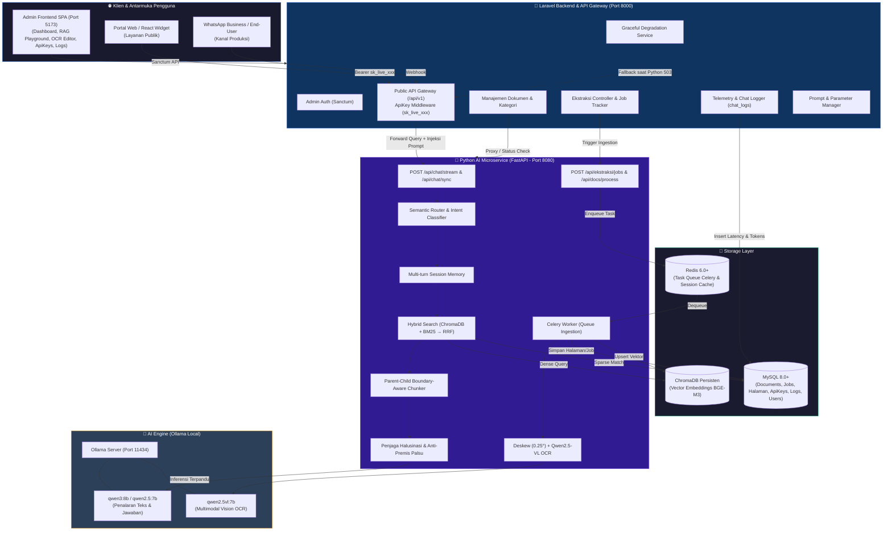
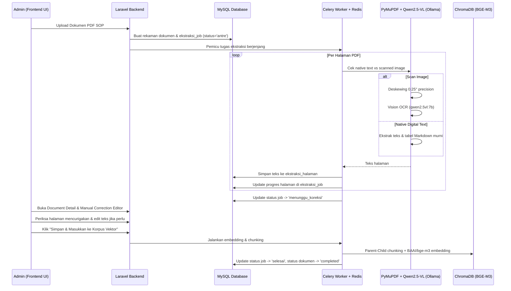
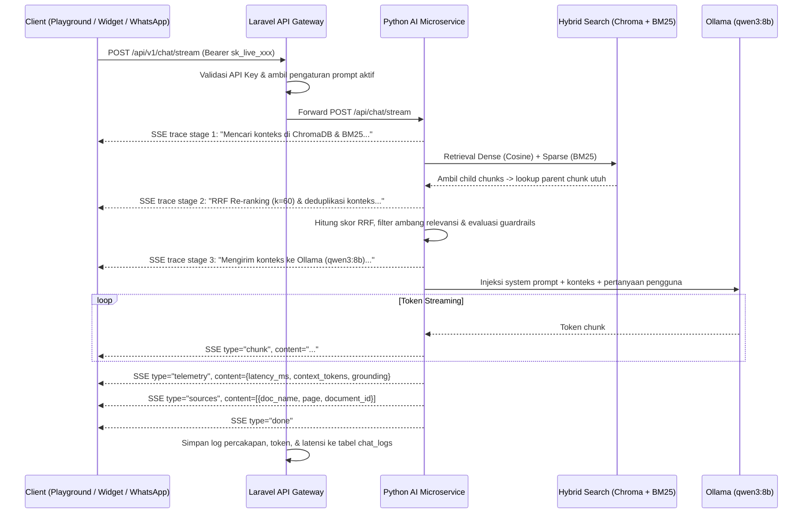
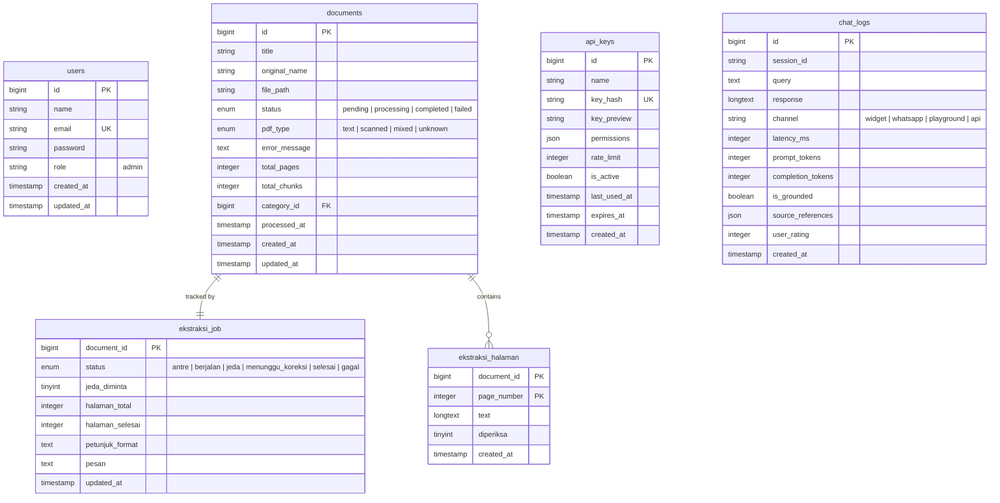

# 🏗️ Arsitektur Sistem — Agentic IT Support Copilot & Central RAG Hub

## 1. Diagram Arsitektur Keseluruhan



---

## 2. Alur Kerja Komponen Utama

### A. Alur Ingestion & Ekstraksi Bertahap (Step-by-Step with Manual Correction)



### B. Alur Inferensi RAG & Live Pipeline Tracing (Playground & Public API)



---

## 3. Struktur Proyek Terkini

```
agentic-ai/
├── admin-frontend/         # Dashboard Manajemen & RAG Playground (React + Vite + Tailwind)
│   ├── src/
│   │   ├── api/            # Client API (documents, categories, apiKeys, chatLogs, settings, mesin)
│   │   ├── components/     # Layout, Modal, ManualCorrectionEditor, EmbedProgressModal, Settings
│   │   ├── pages/          # Dashboard, DocumentDetail, Categories, ApiKeys, ChatLogs, Mesin, Settings
│   │   └── services/       # SSE Stream singleton & persistent tracing state
│   ├── package.json
│   └── vite.config.js
│
├── laravel-admin/          # Backend Admin API, Auth Sanctum & API Gateway (Laravel 11)
│   ├── app/
│   │   ├── Http/Controllers/Api/
│   │   │   ├── AuthController.php          # Login & Admin Token
│   │   │   ├── DocumentController.php      # Upload, Sync, & Manage Documents
│   │   │   ├── EkstraksiController.php     # Multi-step OCR Extraction Endpoints
│   │   │   ├── ApiKeyController.php        # External API Key Management
│   │   │   ├── ChatLogController.php       # Telemetry & Audit Logs
│   │   │   ├── SettingController.php       # LLM Prompts, WhatsApp & System Settings
│   │   │   ├── FastPathController.php      # Quick Responses / Shortcuts
│   │   │   ├── DirectoryController.php     # Service Directory Lookup
│   │   │   └── V1/                         # Public API Gateway Endpoints
│   │   ├── Http/Middleware/
│   │   │   └── ApiKeyMiddleware.php        # Otentikasi Public API Gateway
│   │   ├── Models/
│   │   │   ├── Document.php, DocumentLog.php
│   │   │   ├── EkstraksiJob.php, EkstraksiHalaman.php
│   │   │   ├── ApiKey.php, ChatLog.php
│   │   │   └── ChatbotFastPath.php, ChatbotDirectory.php
│   │   └── Services/
│   │       ├── AiMicroserviceClient.php    # HTTP & SSE Client ke Python
│   │       └── GracefulDegradationService.php # Fallback Handler saat AI Down
│   ├── routes/
│   │   └── api.php                         # Routing Sanctum, Admin, & V1 Gateway
│   └── database/migrations/                # Skema Database MySQL
│
├── python-ai/              # AI Microservice RAG, Hybrid Search & OCR (FastAPI + Celery)
│   ├── app/
│   │   ├── main.py                         # FastAPI App & Middleware
│   │   ├── config.py                       # Settings & Environment Variables
│   │   ├── database.py                     # SQLAlchemy MySQL Connector
│   │   ├── schemas.py                      # Pydantic Schemas
│   │   ├── routers/
│   │   │   ├── chat.py                     # Streaming & Synchronous Chat Endpoints
│   │   │   ├── documents.py                # Direct Document Processing Endpoints
│   │   │   └── ekstraksi.py                # Granular Page Extraction Endpoints
│   │   ├── services/
│   │   │   ├── rag_service.py              # Hybrid Search, RRF, Prompt Assembly & Guards
│   │   │   ├── embedding_service.py        # BGE-M3 Embedder & ChromaDB Manager
│   │   │   ├── pdf_processor.py            # PyMuPDF, Deskewing, & Qwen2.5-VL Vision OCR
│   │   │   ├── ekstraksi_bertahap.py       # Page-by-page pipeline orchestrator
│   │   │   ├── session_memory.py           # Multi-turn conversation buffer with TTL
│   │   │   └── tool_router.py              # Semantic intent & fast-path dispatcher
│   │   └── tasks/
│   │       ├── process_document.py         # Celery Task: Legacy Document Ingestion
│   │       └── ekstraksi.py                # Celery Task: Granular Step Extraction
│   ├── requirements.txt
│   └── reset_jobs.py                       # Pembersih status pekerjaan tertahan
│
├── docs/                   # Spesifikasi Teknis, Arsitektur, Panduan Integrasi, dan Telemetri
├── start-all.sh            # Skrip orkestrasi peluncur seluruh layanan (Single Command)
└── stop-all.sh             # Skrip penghentian seluruh layanan
```

---

## 4. Skema Database Relasional (MySQL)



---

## 5. Ringkasan Port dan Komunikasi Antar Servis

| Layanan | Host & Port | Protokol | Autentikasi | Konsumen |
| :--- | :--- | :--- | :--- | :--- |
| **Admin Frontend** | `http://localhost:5173` | HTTP / SSE | Browser Web | Administrator Sistem |
| **Laravel Backend** | `http://localhost:8000` | HTTP REST / JSON | Bearer Sanctum Token | Admin Frontend |
| **Public API Gateway** | `http://localhost:8000/api/v1` | HTTP / SSE | Bearer API Key (`sk_live_xxx`) | Portal Web, WhatsApp, CRM |
| **Python AI Microservice** | `http://localhost:8080` | HTTP REST / SSE | Bearer Internal Secret | Laravel Gateway |
| **Ollama LLM Engine** | `http://localhost:11434` | HTTP REST | Internal Localhost | Python AI Microservice |
| **ChromaDB** | Local Embedded Path | Native Python API | Local File Lock | Python AI Microservice |
| **Redis Broker** | `localhost:6379` | TCP Redis Protocol | Internal Localhost | Celery Worker & FastAPI |
| **MySQL Server** | `localhost:3306` | TCP MySQL Protocol | User / Password | Laravel & Python AI |
