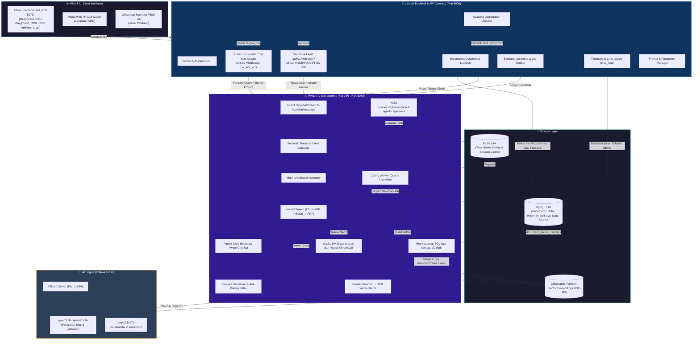
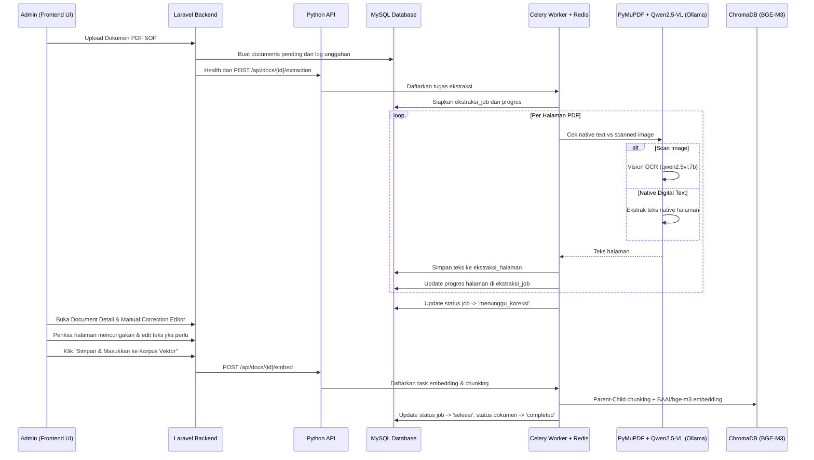
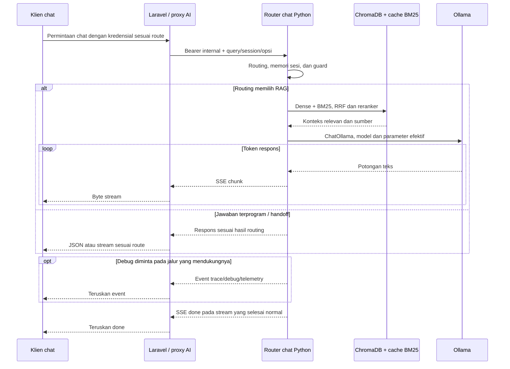
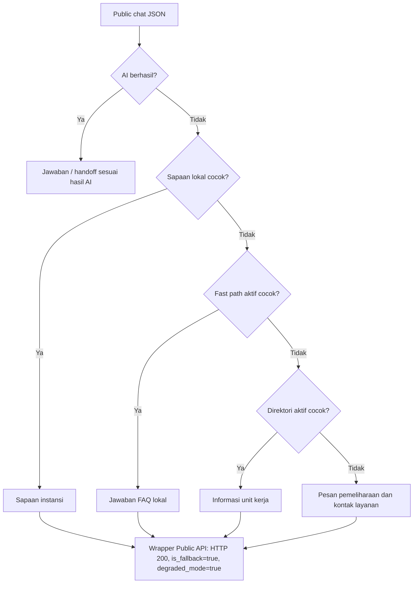
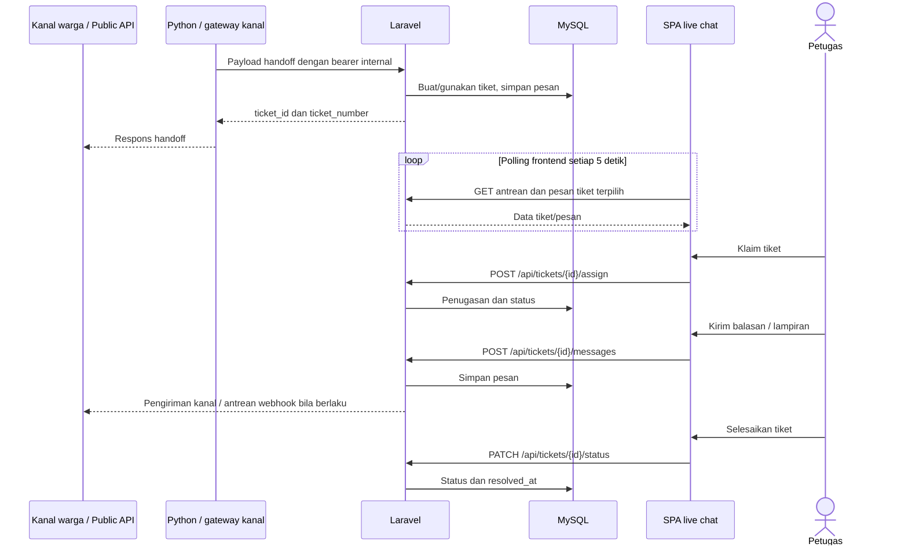
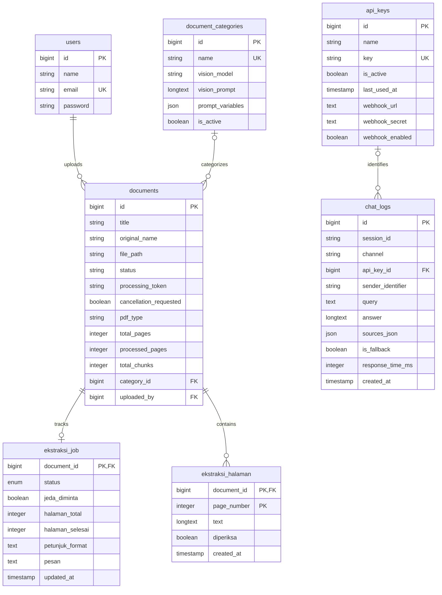

# 🏗️ Arsitektur Sistem — Agentic IT Support Copilot & Central RAG Hub

Dokumen ini menjelaskan hubungan layanan, penyimpanan dan alur sistem.
Untuk detail modul gunakan [panduan pemeliharaan](08-panduan-struktur-kode-dan-pemeliharaan.md),
untuk algoritme gunakan [arsitektur RAG](05-arsitektur-rag-python-ai.md), dan
untuk payload/status HTTP gunakan [spesifikasi API](03-api_spec_agentic_copilot.md).
Model dan port mengikuti konfigurasi; diagram bukan bukti deployment atau benchmark.

## 1. Diagram Arsitektur Keseluruhan



---

Reverb dapat dipakai sebagai driver broadcast bila dipasang dan dijalankan pada deployment. Frontend live chat saat ini menyelaraskan data lewat polling; diagram tidak menganggap ada subscription Echo/WebSocket pada SPA.

Untuk profil API dan worker terpisah, Chroma pada diagram dijalankan sebagai
satu server bersama dengan `CHROMA_HTTP_HOST`/`CHROMA_HTTP_PORT` yang sama pada
kedua pemanggil. Host kosong tetap mengaktifkan mode embedded lama. Runner
integrasi memakai server sementara; konfigurasi launcher/deployment lama perlu
disesuaikan tersendiri dan tidak diubah otomatis oleh pengujian.

## 2. Alur Kerja Komponen Utama

### A. Alur Ingestion & Ekstraksi Bertahap (Step-by-Step with Manual Correction)

Dua tahap manual adalah pemeriksaan teks serta tindakan simpan korpus. Pratinjau chunk membantu pemilihan parameter; diagram tidak menyatakan bahwa API mewajibkan setiap halaman telah diberi tanda diperiksa.



Unggah mengikuti format yang diizinkan controller, termasuk PDF serta beberapa
format dokumen/gambar, dengan batas 50 MB. Nama berkas memakai hash UUID, waktu
dan isi; ini bukan deduplikasi berdasarkan isi saja. Render citra untuk OCR dan
editor memiliki batas berbeda, dijelaskan pada
[arsitektur RAG](05-arsitektur-rag-python-ai.md#citra-halaman-untuk-editor-koreksi).

### B. Alur Inferensi RAG dan Streaming

Chat JSON publik memakai `POST /api/v1/chat`; stream publik memakai `/api/v1/chat/stream`. Sandbox admin memakai jalur proxy AI dan dapat meminta metadata debug. Gateway stream publik meneruskan byte SSE tanpa meminta debug serta tidak membuat `ChatLog` pada implementasi saat ini.



Penyimpanan metadata log JSON/kanal mengikuti pemanggil Laravel. Jenis event dan payload mengacu ke [spesifikasi API](03-api_spec_agentic_copilot.md); trace tiga tahap bukan jaminan bahwa setiap pertanyaan menjalankan model atau retrieval.

---

### C. Fallback ketika AI gagal



Diagram menunjukkan jalur kegagalan AI pada Public API JSON. Middleware dan validasi tetap dapat menghasilkan 401/422; ini bukan jaminan bahwa seluruh endpoint selalu membalas 200. Helper fallback lokal memiliki flag hasilnya sendiri, sedangkan wrapper Public API menetapkan flag degradasi. Stream publik memiliki kebijakan fallback berdasarkan byte/error transportnya; webhook kanal mempertahankan kebijakan respons masing-masing.

### D. Handoff dan tindak lanjut petugas



Broadcast event tetap disediakan backend kepada konsumennya. Pembaruan pada SPA mengikuti polling dan event browser lokal `app-tickets-updated`; diagram ini tidak menjanjikan delivery kanal berhasil hanya karena pesan sudah tersimpan.

Penerimaan tiket mempertahankanaturan sesi, kontak, tanggal, status aktif, dan pembukaan ulang. Entity extractor Laravel juga dapat membaca riwayat Redis DB 2 serta memperkaya tiket dari pesan baru. Catatan internal petugas tidak dikirim ke kanal keluar.

---

## 3. Struktur Proyek Terkini

```
agentic-ai/
├── admin-frontend/         # Dashboard Manajemen & RAG Playground (React + Vite + Tailwind)
│   ├── src/
│   │   ├── api/            # Client API (documents, categories, apiKeys, chatLogs, settings, mesin)
│   │   ├── components/     # Layout, Modal, ManualCorrectionEditor, EmbedProgressModal, Settings
│   │   ├── hooks/          # State/workflow tickets, editor dokumen, dan settings
│   │   ├── pages/          # Dashboard, DocumentDetail, Categories, ApiKeys, ChatLogs, Mesin, Settings
│   │   └── services/       # Orkestrasi data live chat dan SSE singleton persisten
│   ├── package.json
│   └── vite.config.js
│
├── laravel-admin/          # Backend Admin API, Auth Sanctum & API Gateway (Laravel 13)
│   ├── app/
│   │   ├── Http/Controllers/Api/
│   │   │   ├── AuthController.php          # Login & Sesi Cookie Sanctum
│   │   │   ├── DocumentController.php      # Upload, Sync, & Manage Documents
│   │   │   ├── EkstraksiController.php     # Multi-step OCR Extraction Endpoints
│   │   │   ├── ApiKeyController.php        # External API Key Management
│   │   │   ├── ChatLogController.php       # Telemetry & Audit Logs
│   │   │   ├── SettingController.php       # Alias kompatibilitas prompt bawaan
│   │   │   ├── Settings/                   # HTTP pengaturan kanal, chatbot, dan diagnostik
│   │   │   ├── FastPathController.php      # Quick Responses / Shortcuts
│   │   │   ├── DirectoryController.php     # Service Directory Lookup
│   │   │   └── V1/                         # Public API Gateway Endpoints
│   │   ├── Http/Middleware/
│   │   │   └── AuthenticateApiKey.php      # Otentikasi Public API Gateway
│   │   ├── Models/
│   │   │   ├── Document.php, DocumentLog.php
│   │   │   ├── EkstraksiJob.php, EkstraksiHalaman.php
│   │   │   ├── ApiKey.php, ChatLog.php
│   │   │   └── ChatbotFastPath.php, ChatbotDirectory.php
│   │   └── Services/
│   │       ├── Documents/                 # Workflow berkas, ekstraksi, opsi kategori, dan format respons
│   │       ├── Tickets/                   # Ingestion, query, lifecycle, reply, delivery
│   │       ├── Entities/                  # Trait normalisasi, parsing, Redis history, enrichment
│   │       ├── Channels/                  # Inbound kanal, polling, profil Telegram, transport AI
│   │       ├── Settings/                  # Persistensi pengaturan dan katalog model
│   │       ├── WhatsAppClient.php         # Konfigurasi kanal dan pengiriman balasan
│   │       ├── WhatsAppGateway.php        # Payload HTTP Meta/gateway generik
│   │       ├── AiMicroserviceClient.php   # Titik masuk kompatibel HTTP dokumen Python
│   │       ├── Ai/                        # Trait DocumentRequests dan StagedExtractionRequests
│   │       └── GracefulDegradationService.php # Fallback Handler saat AI Down
│   ├── routes/
│   │   └── api.php                         # Routing Sanctum, Admin, & V1 Gateway
│   └── database/migrations/                # Skema Database MySQL
│
├── python-ai/              # AI Microservice RAG, Hybrid Search & OCR (FastAPI + Celery)
│   ├── app/
│   │   ├── main.py                         # FastAPI App & Middleware
│   │   ├── config.py                       # Settings & Environment Variables
│   │   ├── celery_app.py                   # Satu instance Celery bersama
│   │   ├── database.py                     # Ekspor query MySQL kompatibel
│   │   ├── repositories/                   # connection, documents, settings, directories, document_logs
│   │   ├── schemas.py                      # Pydantic Schemas
│   │   ├── routers/
│   │   │   ├── chat.py                     # Streaming & Synchronous Chat Endpoints
│   │   │   ├── documents.py                # Direct Document Processing Endpoints
│   │   │   ├── ekstraksi.py                # Granular Page Extraction Endpoints
│   │   │   └── health.py                   # HTTP/cache health publik dan hardware bertoken
│   │   ├── services/
│   │   │   ├── document_operations.py       # Token generasi, cancellation dan lock dokumen
│   │   │   ├── document_workflows/         # Query, lifecycle, citra, prompt, kendali, koreksi, chunk
│   │   │   ├── task_workflows/             # Legacy ingest, ekstraksi, embedding, cleanup
│   │   │   ├── diagnostics/                # Probe health serta pembacaan/estimasi hardware
│   │   │   ├── rag_service.py              # Orkestrasi chat dan titik masuk kompatibel
│   │   │   ├── rag/                        # retrieval, grounding, generation, prompts
│   │   │   ├── backend_client.py           # Handoff tiket ke Laravel
│   │   │   ├── embedding_service.py        # Ekspor embedding/chunking/vektor kompatibel
│   │   │   ├── embeddings/                 # models, chunking, vector_store, corpus
│   │   │   ├── pdf_processor.py            # Ekspor PDF/OCR kompatibel
│   │   │   ├── ocr/                        # pdf_io, prompts, vision, sop, cleanup, pipeline
│   │   │   ├── ekstraksi_bertahap.py       # Ekspor workflow/penyimpanan kompatibel
│   │   │   ├── extraction/                 # contracts, workflow, mysql_storage, memory_storage
│   │   │   ├── session_memory.py           # Multi-turn conversation buffer with TTL
│   │   │   ├── tool_router.py              # Ekspor intent/tool kompatibel
│   │   │   └── routing/                    # dispatch, language, patterns, semantic, citizen, calendar
│   │   └── tasks/
│   │       ├── process_document.py         # Celery Task: Legacy Document Ingestion
│   │       └── ekstraksi.py                # Celery Task: Granular Step Extraction
│   ├── requirements.txt
│   └── reset_jobs.py                       # Pembersih status pekerjaan tertahan
│
├── docs/                   # Spesifikasi Teknis, Arsitektur, Panduan Integrasi, dan Telemetri
├── start-all.sh            # Skrip orkestrasi peluncur seluruh layanan (Single Command)
└── stop-all.sh             # Skrip penghentian seluruh layanan
```

---

## 4. Skema Database Relasional (MySQL)

Diagram berikut adalah subset kolom yang dipakai integrasi saat ini. Migrasi Laravel menjadi sumber kebenaran untuk keseluruhan skema, nullable/default, dan indeks. `documents.status` berupa string setelah migrasi perubahan status; `ekstraksi_halaman` memakai primary key gabungan.



API key saat ini dicocokkan dengan kolom `key`; hashing, kuota per key, dan permission granular belum tersedia pada model/middleware ini. Secret webhook memakai cast enkripsi Laravel. Public API JSON dan handler kanal menyimpan metadata sesuai kebijakan `ChatLog`; tampilan log tidak menyediakan transkrip atau rating pengguna.

---

## 5. Ringkasan Port dan Komunikasi Antar Servis

| Layanan | Host & Port | Protokol | Autentikasi | Konsumen |
| :--- | :--- | :--- | :--- | :--- |
| **Admin Frontend** | `http://localhost:5173` | HTTP / SSE | Browser Web | Administrator Sistem |
| **Laravel Backend** | `http://localhost:8000` | HTTP REST / JSON | Cookie sesi Sanctum (SPA) | Admin Frontend |
| **Public API Gateway** | `http://localhost:8000/api/v1` | HTTP / SSE | Bearer API Key (`sk_live_xxx`) | Klien chat eksternal: portal, CRM, atau bot mandiri |
| **Python AI Microservice** | `http://localhost:8080` | HTTP REST / SSE | Bearer Internal Secret | Laravel Gateway |
| **Ollama LLM Engine** | `http://localhost:11434` | HTTP REST | Internal Localhost | Python AI Microservice |
| **ChromaDB** | Server bersama melalui `CHROMA_HTTP_HOST` / path embedded satu proses | HTTP client / native Python API | Konfigurasi deployment | Python API dan worker |
| **Redis Broker** | `localhost:6379` | TCP Redis Protocol | Internal Localhost | Celery Worker & FastAPI |
| **MySQL Server** | `localhost:3306` | TCP MySQL Protocol | User / Password | Laravel & Python AI |
