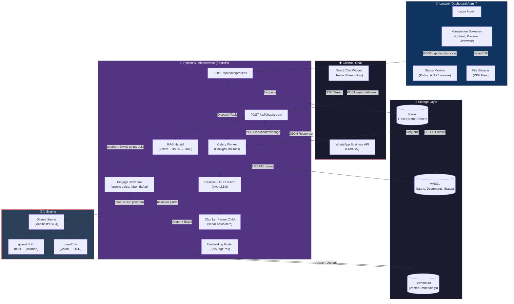
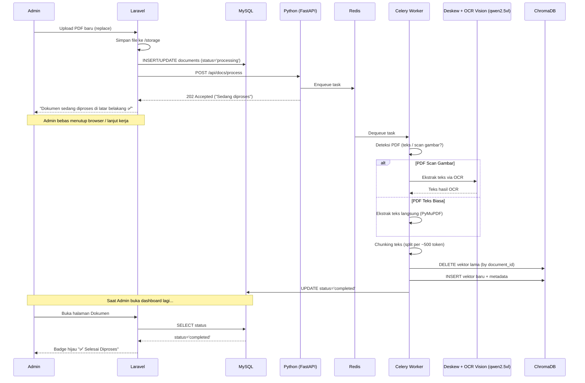
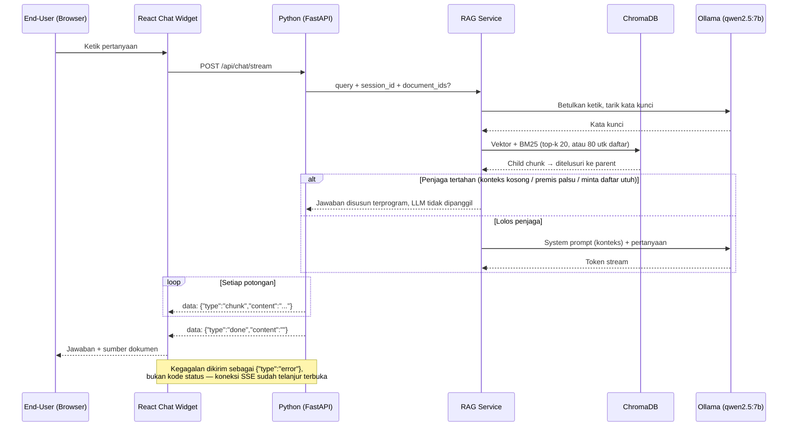
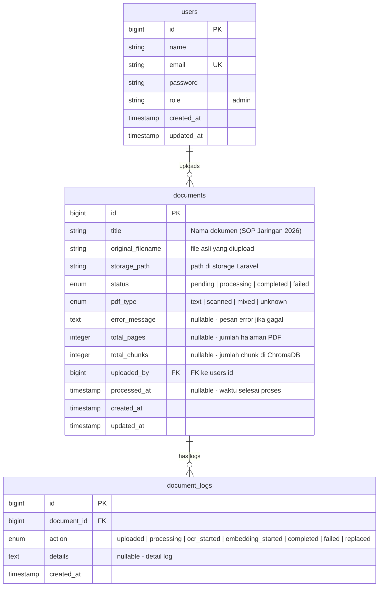

# 🏗️ Arsitektur Sistem — Agentic IT Support Copilot

## 1. Diagram Arsitektur Keseluruhan



---

## 2. Alur Data Detail

### A. Alur Upload & Pemrosesan Dokumen (Admin)



### B. Alur Chat — Testing (React Widget)



### C. Alur Chat — Produksi (WhatsApp)

```mermaid
sequenceDiagram
    participant User as End-User (HP)
    participant WA as WhatsApp Business API
    participant FastAPI as Python (FastAPI)
    participant RAG as RAG Service
    participant ChromaDB
    participant Ollama as Ollama (qwen2.5:7b)

    User->>WA: Kirim pesan WhatsApp
    WA->>FastAPI: POST /api/chat/message (webhook)

    FastAPI->>RAG: query + session_id
    RAG->>ChromaDB: Vektor + BM25 (top-k 20, atau 80 utk daftar)
    ChromaDB-->>RAG: Child chunk → ditelusuri ke parent
    RAG->>Ollama: System prompt (konteks) + pertanyaan
    Ollama-->>RAG: Jawaban utuh

    FastAPI-->>WA: JSON {reply, sources[]}
    WA-->>User: Pesan balasan otomatis di WhatsApp

    Note over FastAPI,WA: Mesin RAG-nya sama dengan jalur widget;<br/>bedanya hanya jawaban dikirim utuh, bukan dialirkan
```

---

## 3. Struktur Proyek

```
agentic-ai/
├── 📁 laravel-admin/              # Dashboard Admin (Laravel)
│   ├── app/
│   │   ├── Http/Controllers/
│   │   │   ├── AuthController.php
│   │   │   └── DocumentController.php
│   │   ├── Models/
│   │   │   ├── User.php
│   │   │   └── Document.php
│   │   └── Services/
│   │       └── AiMicroserviceClient.php    # HTTP client ke Python
│   ├── resources/views/
│   │   ├── dashboard.blade.php
│   │   └── documents/
│   │       ├── index.blade.php             # Daftar PDF + status badge
│   │       └── show.blade.php              # Preview PDF (PDF.js)
│   ├── routes/
│   │   └── web.php
│   ├── database/migrations/
│   │   └── xxxx_create_documents_table.php
│   ├── .env
│   └── docker/
│       └── Dockerfile
│
├── 📁 python-ai/                  # AI Microservice (FastAPI)
│   ├── app/
│   │   ├── main.py                         # FastAPI entry point
│   │   ├── config.py                       # LLM_MODEL, EMBEDDING_MODEL, dll.
│   │   ├── routers/
│   │   │   ├── documents.py                # POST /api/docs/process
│   │   │   └── chat.py                     # POST /api/chat/stream (SSE)
│   │   ├── services/
│   │   │   ├── pdf_processor.py            # OCR detection + extraction
│   │   │   ├── embedding_service.py        # Chunking + ChromaDB upsert
│   │   │   ├── rag_service.py              # RAG chain (retrieval + LLM)
│   │   │   └── tool_router.py              # Semantic routing / tool calling
│   │   └── tasks/
│   │       └── process_document.py         # Celery async task
│   ├── requirements.txt
│   ├── .env
│   └── docker/
│       └── Dockerfile
│
├── 📁 react-widget/               # Chat Widget — TESTING ONLY (React.js)
│   ├── src/
│   │   ├── App.jsx
│   │   ├── components/
│   │   │   ├── ChatWidget.jsx
│   │   │   ├── MessageBubble.jsx
│   │   │   └── SourceReference.jsx
│   │   └── hooks/
│   │       └── useStreamChat.js            # SSE stream handler
│   ├── package.json
│   └── vite.config.js
│   ⚠️ Folder ini TIDAK di-deploy ke produksi.
│      Produksi menggunakan WhatsApp Business API webhook.
│
├── 📄 docker-compose.yml          # Orkestrasi semua service
├── 📄 .env.example                # Template environment variables
└── 📄 README.md
```

---

## 4. Skema Database (MySQL — Laravel)



### Penjelasan Kolom Penting

| Kolom           | Fungsi                                                                                              |
| --------------- | --------------------------------------------------------------------------------------------------- |
| `status`        | Digunakan Laravel untuk menampilkan badge warna (kuning=processing, hijau=completed, merah=failed)  |
| `pdf_type`      | Diisi Python setelah deteksi, memberi tahu admin apakah PDF nya text murni atau hasil scan          |
| `total_chunks`  | Diisi Python setelah embedding selesai, membantu admin memahami seberapa "besar" dokumen di mata AI |
| `error_message` | Jika proses OCR/embedding gagal, Python menyimpan pesan error agar admin tahu penyebabnya           |
| `document_logs` | Tabel audit trail — mencatat riwayat setiap aksi pada dokumen                                       |

---

## 5. Konfigurasi Environment (`.env`)

### Python AI Microservice (`python-ai/.env`)

```env
# === LLM Configuration ===
# Dua model dipakai TERPISAH dan itu disengaja:
#   LLM_MODEL_NAME    -> model teks, menyusun jawaban chat
#   VISION_MODEL_NAME -> model multimodal, membaca halaman pindai (OCR)
# Memakai satu model multimodal untuk keduanya membuat chat jauh lebih lambat.
LLM_MODEL_NAME=qwen2.5:7b
VISION_MODEL_NAME=qwen2.5vl
OLLAMA_BASE_URL=http://localhost:11434

# === Embedding ===
# Mengganti model ini menuntut ingest ulang seluruh dokumen —
# vektor lama tidak sebanding dengan vektor model baru.
EMBEDDING_MODEL_NAME=BAAI/bge-m3

# === Vector DB ===
CHROMA_PERSIST_DIR=./data/chromadb

# === Database (Shared with Laravel) ===
MYSQL_HOST=localhost
MYSQL_PORT=3306
MYSQL_DATABASE=agentic_copilot
MYSQL_USER=root
MYSQL_PASSWORD=secret

# === Queue (Celery) ===
CELERY_BROKER_URL=redis://localhost:6379/0
CELERY_RESULT_BACKEND=redis://localhost:6379/1

# === Security ===
INTERNAL_API_TOKEN=your-secure-internal-token-here
```

### Laravel Admin (`laravel-admin/.env`)

```env
# === App ===
APP_NAME="Agentic Copilot Admin"
APP_URL=http://localhost:8000

# === Database ===
DB_CONNECTION=mysql
DB_HOST=127.0.0.1
DB_PORT=3306
DB_DATABASE=agentic_copilot
DB_USERNAME=root
DB_PASSWORD=secret

# === Python Microservice ===
AI_SERVICE_URL=http://localhost:8080
AI_SERVICE_TOKEN=your-secure-internal-token-here
```

---

## 6. Tech Stack Summary

| Layer                     | Teknologi                             | Versi / Catatan                  |
| ------------------------- | ------------------------------------- | -------------------------------- |
| **Dashboard Admin**       | Laravel (PHP)                         | v11.x                            |
| **AI Microservice**       | Python + FastAPI                      | Python 3.11+                     |
| **Chat Widget (Testing)** | React.js + Vite                       | v18+ — dev/demo only             |
| **Channel Produksi**      | WhatsApp Business API                 | Webhook → POST /api/chat/message |
| **LLM Runtime**           | Ollama                                | Latest                           |
| **LLM Model (teks)**      | `qwen2.5:7b`                          | menyusun jawaban, `temperature=0` |
| **LLM Model (vision)**    | `qwen2.5vl`                           | OCR halaman pindai via `/api/generate` |
| **Embedding**             | `BAAI/bge-m3`                         | via SentenceTransformers         |
| **Vector DB**             | ChromaDB                              | Persistent mode, jarak cosine    |
| **Pencarian kata**        | `rank_bm25`                           | digabung dengan vektor lewat RRF |
| **OCR**                   | Model vision (bukan Tesseract)        | perlu pelurusan halaman 0,25° lebih dulu |
| **PDF Parsing**           | PyMuPDF (fitz)                        | Deteksi teks vs scan, render, pelurusan |
| **Penilai evaluasi**      | DeepSeek (RAGAS) + penilai deterministik | model penjawab tidak menilai dirinya sendiri |
| **AI Orchestration**      | LangChain                             | Latest                           |
| **Task Queue**            | Celery + Redis                        | Async background jobs            |
| **Database**              | MySQL                                 | v8.x                             |
| **Containerization**      | Docker Compose                        | Multi-service                    |
