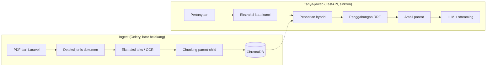
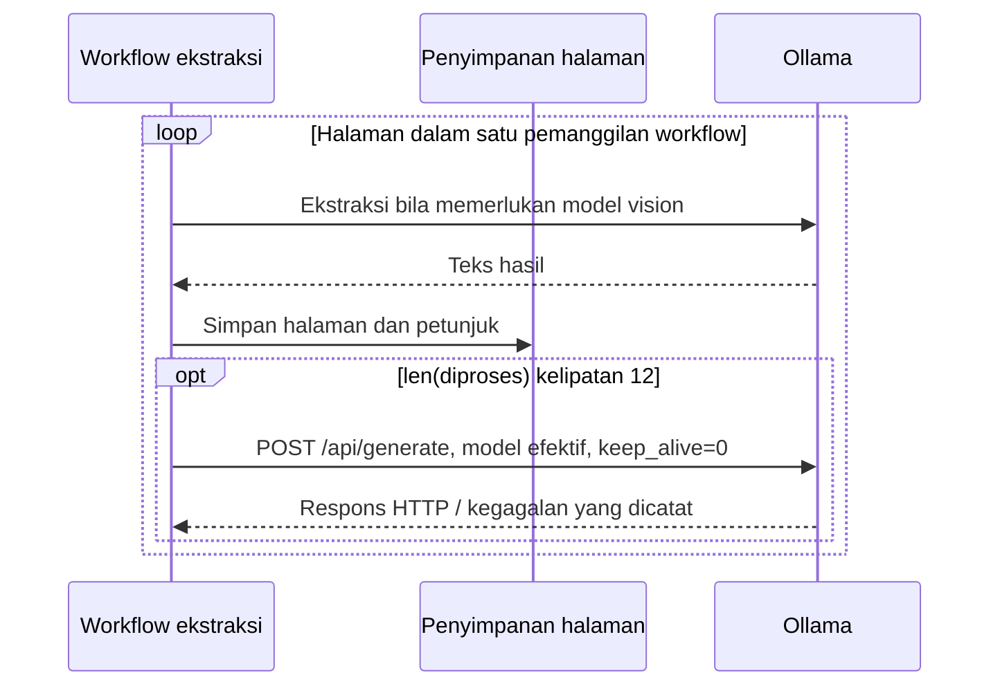

# Arsitektur RAG — AI Microservice (sebagaimana terimplementasi)

Dokumen ini menjelaskan cara kerja pencarian dan penyusunan jawaban di
`python-ai/` **seperti yang benar-benar ada di kode**, bukan seperti yang
direncanakan di awal. Rujukan modul dan nama fungsi digunakan agar alur tetap
bisa ditelusuri setelah kode dipisahkan.

### Peta modul setelah refactor

Semua path berikut relatif terhadap `python-ai/app/services/`:

| Modul | Tanggung jawab |
| --- | --- |
| `rag_service.py` | Titik masuk `generate_response`, routing intent, memori sesi, urutan penjaga, dan penyusunan respons |
| `rag/retrieval.py` | Vector + BM25, cache/lock, filter dokumen, RRF, reranking, parent-child, metadata sitasi |
| `rag/grounding.py` | Pemeriksaan SOP/premis, enumerasi lengkap, label, petunjuk perbandingan dan perhitungan waktu |
| `rag/generation.py` | Riwayat pesan ke model, streaming Ollama, estimasi token, retry alokasi memori |
| `rag/prompts.py` | Prompt bawaan, tanggal berbahasa Indonesia, profil instansi dinamis/fallback |
| `backend_client.py` | Pengiriman handoff tiket ke Laravel |
| `document_workflows/` | Query/status, cleanup pembatalan, citra/prompt, kendali OCR/SSE, koreksi dan preview/embed |
| `vector_cleanup.py` | Outbox SQL cleanup vektor, retry background FastAPI, dan CLI pemulihan |
| `task_workflows/legacy.py` | Pipeline ingest lama beserta retry dan penyelesaian status |
| `task_workflows/extraction.py` | OCR bertahap, pemeriksaan dokumen terhapus, jeda dan penjadwalan lanjutan |
| `task_workflows/embedding.py` | Chunking, penggantian vektor, progres dan status akhir |
| `task_workflows/cleanup.py` | Pemulihan penanda daftar setelah semua halaman terkumpul |
| `embedding_service.py` | Titik masuk kompatibel untuk encoder, chunking, dan penyimpanan vektor |
| `embeddings/models.py` | Model embedding/reranker lazy dan fallback Ollama/cache lokal/unduhan |
| `embeddings/chunking.py` | Judul/konteks halaman, daftar, dan pemotongan parent-child |
| `embeddings/vector_store.py` | Client Chroma HTTP/embedded lazy, baca/hapus chunk, upsert parent dan child |
| `embeddings/corpus.py` | Penanda korpus di disk serta invalidasi BM25 pada proses saat ini |
| `ekstraksi_bertahap.py` | Titik masuk kompatibel untuk status, laporan, workflow, serta penyimpanan |
| `extraction/contracts.py` | Status, protokol `Penyimpanan`, dan dataclass `Kemajuan` |
| `extraction/workflow.py` | Ekstraksi per halaman, simpan petunjuk, jeda/resume, dan flush cache |
| `extraction/mysql_storage.py` | Halaman/job MySQL dan progres embedding Redis |
| `extraction/memory_storage.py` | Penyimpanan CLI satu proses |
| `pdf_processor.py` | Ekspor kompatibilitas fungsi PDF/OCR dan konstanta diagnostik |
| `ocr/pdf_io.py` | Resolusi path, render editor, ukuran/deteksi halaman, teks PDF native |
| `ocr/prompts.py` | Prompt dasar/formulir dan penyisipan kata kunci kategori |
| `ocr/vision.py` | Pemilihan model vision, cache autodeteksi 60 detik, request/retry Ollama |
| `ocr/sop.py` | Deteksi formulir serta pemeriksaan kepala/NIP dan OCR ulang |
| `ocr/cleanup.py` | Pembersihan respons dan perbaikan penanda daftar lintas halaman |
| `ocr/pipeline.py` | Halaman native/gambar, gambar tertanam, dan pewarisan petunjuk |
| `tool_router.py` | Ekspor kompatibilitas intent, normalisasi, data warga, dan kalkulasi |
| `routing/dispatch.py` | Urutan pemilihan intent dan pembentukan payload routing |
| `routing/language.py` | Slang, filler, keyword, dan penjaga kalimat tanya |
| `routing/patterns.py` | Pola rangkuman, sapaan, handoff, koreksi, dan kalkulator |
| `routing/semantic.py` | Cache anchor embedding dan klasifikasi intent |
| `routing/citizen.py` | Nama warga, instansi, dan ringkasan kendala |
| `routing/calendar.py` | Tanggal/durasi, pengayaan fakta, dan kalkulator hari kerja |

`rag_service.generate_response` dan `rag_service.invalidate_bm25_cache` tetap
tersedia untuk router, skrip, dan worker lama. Cache BM25 hanya dimiliki modul
retrieval. Logger memakai nama lama `app.services.rag_service` agar penyaringan
log tetap cocok. Pemisahan ini mempertahankan prompt, algoritme, dan format
respons; tes kontrak berada di `python-ai/tests/`.

Path publik `embedding_service` dan `ekstraksi_bertahap` tetap tersedia.

Untuk API dan worker pada proses terpisah, `CHROMA_HTTP_HOST` memilih satu
server Chroma bersama; port/SSL diatur lewat `CHROMA_HTTP_PORT` dan
`CHROMA_HTTP_SSL`. Host kosong mempertahankan client embedded satu proses.
Pengujian integrasi menemukan kegagalan pembacaan segmen HNSW pada profil
embedded lintas proses dan memverifikasi alur sampai retrieval melalui HTTP.
Penanda korpus pada `CHROMA_PERSIST_DIR` tetap perlu terlihat oleh kedua proses.
Lihat [runner dan hasil pengujian](09-status-refactor-dan-verifikasi.md).

Model/reranker hanya disimpan di `embeddings/models.py`, koleksi ChromaDB hanya
di `embeddings/vector_store.py`, dan cache BM25 tetap di `rag/retrieval.py`.
Ekspor kompatibilitas tidak membuat salinan cache tersebut. Cache pilihan model
vision hanya dimiliki `ocr/vision.py`, sedangkan cache anchor intent hanya
dimiliki `routing/semantic.py`. `pdf_processor` dan `tool_router` tetap
menyediakan fungsi serta konstanta yang dipakai konsumen lama. Logger kedua
paket tetap memakai nama modul lama; algoritme dan prompt tidak diubah.

Di luar direktori services, `python-ai/app/celery_app.py` membuat satu instance
Celery. Kedua modul task memakai instance itu, sehingga tidak saling mengimpor
untuk memperoleh aplikasi. Worker tetap dijalankan melalui
`app.tasks.process_document.celery_app`, yang memuat registrasi ketiga task.

Router mempertahankan dependency, schema, signature, dan metadata OpenAPI;
body workflow berada di `services/document_workflows/`. Modul task
mempertahankan decorator, nama, dan argumen posisi Celery; hardening cancel
menambah keyword internal opsional `_operation_token`. Body workflow berada
di `services/task_workflows/`. Task instance dan collaborator diteruskan
secara eksplisit agar retry, requeue, logger dan dependency tiruan tetap
mengikuti pemanggilnya. Helper lookup/storage ekstraksi dimiliki
`document_workflows/extraction_control.py` dan dipakai modul koreksi/chunk.

Pembatalan menggunakan token generasi dan flag persisten pada baris dokumen.
Task baru, retry, dan kelanjutan membawa `_operation_token`; worker memeriksa
token sebelum/sesudah inferensi serta di dalam lock saat menulis SQL/vektor.
Cancel tidak melakukan purge atau unload model bersama. Hasil inferensi lama
dibuang pada batas berikutnya, termasuk jika resume telah membuat token baru.
Status dan progres Redis generasi lama tidak menimpa generasi yang baru.
Rincian migrasi dan batas cleanup ada pada
[catatan verifikasi](09-status-refactor-dan-verifikasi.md) serta README Python.

`services/vector_cleanup.py` mengelola outbox SQL `document_vector_cleanups`.
Request dibuat pada transaksi fence Laravel/Python sebelum I/O ke Chroma dan
bertahan setelah dokumen dihapus. Drainer lifespan FastAPI bekerja pada thread
saat startup dan setiap 30 detik; kegagalan memakai backoff hingga 300 detik.
Token scope mempertahankan generasi baru, sedangkan cleanup penuh menahan start
baru sampai request selesai. Semua timestamp outbox memakai UTC. Tidak ada
task/antrean Celery baru; retry manual tersedia melalui modul CLI yang sama.
Ini pemulihan eventual; publikasi korpus lintas SQL/Chroma belum atomik.

Dokumen [`02-arsitektur_sistem_agentic_copilot.md`](02-arsitektur_sistem_agentic_copilot.md)
menjelaskan arsitektur ketiga komponen secara keseluruhan; yang ini khusus
bagian AI-nya.

## 0. Lingkup: dokumen generik, bukan satu jenis dokumen

Layanan ini menerima **dokumen apa pun yang diunggah admin** lewat panel web —
peraturan, panduan, manual, notulen, formulir. Jalur pemrosesan mendukung
beberapa jenis dokumen, dengan aturan khusus untuk format formulir SOP.
Implementasi saat ini masih memuat preset instansi pada prompt/profil fallback,
kamus akronim, dan anchor pencarian SOP. Dukungan dokumen generik tidak berarti
seluruh aturan domain telah dapat dikonfigurasi.

Arah pengembangan dokumen generik terlihat pada tiga mekanisme berikut:

- Judul dokumen **diturunkan dari isi dokumen itu sendiri**, bukan ditulis di
  kode (§2.4). Judul yang dipatok akan menempel keliru ke setiap dokumen baru.
- Kata pembeda antar bagian **diturunkan dari label yang benar-benar ada di
  korpus** (§3.8), sehingga mekanisme yang sama bekerja pada dokumen perizinan,
  kepegawaian, atau apa pun tanpa satu baris kode berubah.
- Penjaga yang hanya masuk akal untuk satu format dokumen **dibatasi secara
  eksplisit** agar tidak menolak pertanyaan yang sah pada dokumen lain (§3.6).

**Tentang contoh-contoh di dokumen ini.** Seluruh angka dan kasus nyata di sini
berasal dari satu korpus percobaan: berkas SOP Diskominfotik Banda Aceh
(171 halaman, 170 di antaranya pindaian; selama pengembangan dipakai petikan
10 halaman). Korpus itu dipilih karena tersedia dan karena bentuknya sulit —
tabel bagan alir hasil pindai adalah kasus terburuk yang realistis. **Ia contoh
uji, bukan sasaran.** Setiap kali sebuah mekanisme dijelaskan dengan contoh SOP,
yang perlu dibaca adalah mekanismenya; contohnya kebetulan.

## 0.1 Tumpukan teknologi yang benar-benar dipakai

| Peran              | Teknologi                                      | Catatan                                                          |
| ------------------ | ---------------------------------------------- | ---------------------------------------------------------------- |
| Kerangka API       | FastAPI                                        | streaming SSE + endpoint non-streaming                           |
| Penyusun jawaban   | Ollama — `qwen2.5:7b`                          | model **teks**, `temperature=0`, `reasoning=False`               |
| OCR halaman pindai | Ollama — `qwen2.5vl`                           | model **vision** lewat REST `/api/generate`. **Bukan** Tesseract |
| Embedding          | `BAAI/bge-m3`                                  | via `sentence-transformers`                                      |
| Database vektor  | ChromaDB                                       | koleksi `documents`, jarak cosine                                |
| Pencarian kata     | `rank_bm25`                                    | digabung dengan vektor lewat RRF                                 |
| Antrean ingest     | Celery + Redis                                 | ingest berjalan di proses terpisah                               |
| Status dokumen     | MySQL                                          | dibaca panel admin Laravel                                       |
| Penilai evaluasi   | DeepSeek (RAGAS) + penilai fakta deterministik | model penjawab tidak menilai dirinya sendiri                     |

Dua model Ollama dipakai **terpisah dan disengaja**: `qwen2.5vl` multimodal
untuk membaca gambar halaman, `qwen2.5:7b` teks-saja untuk menyusun jawaban.
Memakai satu model multimodal untuk keduanya pernah dicoba dan membuat jawaban
chat jauh lebih lambat tanpa keuntungan apa pun.

---

## 1. Dua alur besar



Keduanya berjalan di **proses yang terpisah**: ingest di pekerja Celery,
tanya-jawab di server FastAPI. Keduanya membaca direktori ChromaDB yang sama.

---

## 2. Ingest

### 2.1 Ekstraksi teks

`document_processor.detect_document_type()` menentukan jalur format dokumen.
Untuk PDF, `ocr/pdf_io.py::detect_pdf_type` memberi klasifikasi teks/pindai/mixed,
sedangkan `ocr/pipeline.py::_ekstrak_halaman` memilih jalur tiap halaman berdasarkan
teks native yang berhasil dibaca.

Halaman dengan teks native minimal 300 karakter mempertahankan teks tersebut;
gambar tertanam yang signifikan tetap dapat diekstrak melalui vision. Halaman
dengan teks lebih sedikit dirender dan dikirim ke Ollama melalui REST
`/api/generate` (`ocr/vision.py::vision_extract_general`).

**Keluaran model vision tidak deterministik.** Bagian formulir dapat terlewat
meskipun OCR mengembalikan teks. `ocr/sop.py::_ocr_dengan_penjaga` memeriksa
halaman yang memuat `Nomor SOP` tetapi kehilangan `Nama SOP` atau baris NIP.
OCR dapat diulang sampai dua kali lagi. Hasil lengkap diprioritaskan; ketika
semua percobaan masih tidak lengkap, hasil yang lebih panjang dipertahankan dan
kehilangan bagian dicatat pada log error. Halaman generik tanpa kepala SOP
tidak ditolak oleh pemeriksaan khusus ini.

#### Prompt OCR: dasar generik, petunjuk format opsional

Prompt dikelola oleh `ocr/prompts.py` dan disusun oleh `ocr/vision.py`:

| Bagian                   | Kapan dipakai         | Isinya                                                                                                                                                                   |
| ------------------------ | --------------------- | ------------------------------------------------------------------------------------------------------------------------------------------------------------------------ |
| `_PROMPT_OCR_DASAR` | Bawaan bila custom `dasar` kosong | Salin teks sesuai gambar, jaga urutan baca/penanda daftar, jangan menebak sel kosong |
| `_PETUNJUK_TABEL_SOP` | Formulir SOP terdeteksi | Format langkah/pelaksana/kelengkapan/waktu/output; dapat diwariskan ke halaman lanjutan |
| `_PETUNJUK_KEPALA_SOP` | Kepala SOP terlihat | Kepala formulir, nama SOP, dan blok pengesahan/NIP; tidak diwariskan ke halaman tanpa kepala |

Sebelumnya seluruh isi kolom kanan ditempelkan ke **setiap** halaman dokumen
apa pun. Itu keliru untuk platform yang menerima unggahan generik: memberi tahu
model bahwa _"dokumen ini terdiri dari HEADER dan TABEL PROSEDUR"_ membuatnya
mencari struktur yang tidak ada pada notulen, surat, atau laporan — dan model
yang diminta mencari sesuatu cenderung menemukannya walau tidak ada.

Deteksinya **diturunkan dari dokumen itu sendiri**, bukan dari nama berkas atau
setelan. `_terlihat_formulir_sop()` mensyaratkan **dua** penanda dari
`nomor sop`, `nama sop`, `uraian prosedur`, `mutu baku`. Satu saja tidak cukup:
kata "nama SOP" bisa muncul di notulen mana pun yang kebetulan membahas SOP,
sedangkan kombinasinya praktis hanya ada pada formulirnya.

Alurnya: halaman pindai pertama dibaca dengan prompt dasar; bila hasilnya
menunjukkan formulir, halaman itu dibaca ulang **sekali** dengan petunjuknya dan
halaman berikutnya langsung memakainya. Ongkosnya paling banyak satu panggilan
tambahan per dokumen, dan dokumen umum tidak pernah menyentuh jalur ini.

#### Penanda daftar yang rontok saat OCR

Daftar resmi Indonesia yang melebihi 26 item memakai huruf yang **diulang**:
`a…z`, lalu `aa…zz`, lalu `aaa…zzz`. Model vision tidak menghitung
pengulangan itu — ia menebak jumlah yang terlihat wajar.

Terukur pada korpus ini: halaman yang seharusnya berpenanda `hhh, iii, jjj,
… vvv` terbaca `h, iii, jj, … vv`. Satu utuh, satu rontok dua huruf, tiga
belas rontok satu. Tidak beraturan — tanda tebakan, bukan aturan. Halaman
sebelumnya yang juga memakai huruf rangkap tiga (`aaa…ggg`) justru terbaca
benar seluruhnya.

Akibatnya jauh lebih besar daripada penanda yang jelek. Penanda yang memendek
terbaca sebagai urutan **mundur**, sehingga daftar 74 item terpecah di batas
halaman menjadi 59 + 15 — lalu yang 59 menang karena lebih panjang, dan
jawaban berhenti di item ke-59 dengan penuh keyakinan. Tidak ada galat yang
muncul; hanya jawaban yang diam-diam kurang.

Ditangani dua lapis:

1. **Saat ingest** (`perbaiki_penanda_daftar`) — penandanya dinormalkan
   kembali. Deterministik, bukan menebak: penerus `ggg` pasti `hhh`. Isi
   itemnya tidak disentuh sama sekali. Dijalankan setelah SELURUH halaman
   terkumpul, karena penanda pertama sebuah halaman hanya bisa disimpulkan
   dari penanda terakhir halaman sebelumnya.
2. **Saat membaca** (`_penanda_maju`) — runtun tetap tersambung bila hurufnya
   maju tepat satu langkah walau panjangnya memendek. Lapis ini yang membuat
   korpus yang **sudah terlanjur tersimpan** tetap terjawab benar tanpa
   menunggu ingest ulang.

Keduanya menolak menyentuh daftar yang memang berbeda: perbaikan hanya
berlaku bila hurufnya sama dengan yang diharapkan dan runtun sebelumnya sudah
cukup panjang. Penanda yang bukan huruf-diulang (`NIP.`, `iv.`) memutus
runtun — tanpa syarat itu, `NIP.196911172001121002` di halaman pengesahan
sempat tercatut sebagai item ke-75.

### 2.2 Chunking parent-child

Satu halaman menghasilkan dua tingkat potongan (`embeddings/chunking.py::chunk_text_hierarchical`):

| Tingkat    | Ukuran         | Tumpang tindih | Perannya                                 |
| ---------- | -------------- | -------------- | ---------------------------------------- |
| **Parent** | 1.500 karakter | 200            | Dikirim ke LLM sebagai konteks yang utuh |
| **Child**  | 300 karakter   | 50             | Di-embed sebagai indeks pencarian        |

Pada jalur hierarkis, pencarian menyentuh **child** dan LLM menerima
**parent**. Fallback untuk data lama dengan chunk flat tetap tersedia.

**Alasannya — dilusi vektor.** Satu halaman SOP bisa memuat 28–59 item.
Bila seluruh halaman dipadatkan jadi satu vektor, satu item hanya menyumbang
sekitar 1/59 bagian dari makna vektor itu dan sinyalnya tenggelam. Potongan
child yang kecil membuat satu item menjadi porsi dominan dari vektornya.

Pengukuran pada 5 kueri terhadap data asli:

| Kueri                        | Halaman benar | Peringkat via vektor halaman | Peringkat via child |
| ---------------------------- | ------------- | ---------------------------- | ------------------- |
| Pelaksanaan Kegiatan Podcast | 6             | 1                            | 1                   |
| Layanan VPN                  | 5             | 1 (skor 0,416)               | 1 (skor **0,651**)  |
| **Pengajuan Cuti Pegawai**   | 4             | **5** ❌                     | **1** ✓             |
| Kunjungan BA Command Centre  | 6             | 3                            | 2                   |
| Layanan Hosting              | 5             | 1                            | 1                   |

### 2.3 Penanganan halaman berisi daftar

Halaman dengan **≥10 item beruntun** (`_LIST_ITEM_THRESHOLD`) diperlakukan
khusus (`_LIST_ITEM_THRESHOLD`, `embeddings/chunking.py`):

- Bila panjangnya ≤6.000 karakter (`_LIST_BLOCK_HARD_CAP`), halaman disimpan
  **utuh sebagai satu parent** supaya tidak ada item yang terpisah dari
  daftarnya.
- Bila lebih panjang, pemecahan dilakukan **di batas item**, bukan di tengah
  karakter (`embeddings/chunking.py::_split_list_preserving_items`).

Aturan batas-item ini juga dipakai untuk child (`embeddings/chunking.py::_split_list_preserving_items`).
Efeknya pada dokumen uji: jumlah child turun dari 82 menjadi 65 — lebih
sedikit, tetapi setiap potongan kini mewakili satu item secara utuh.

### 2.4 Konteks yang disuntikkan ke tiap potongan

Setiap potongan diawali prefix (`embeddings/chunking.py::chunk_text_hierarchical`):

```
[Halaman 4]
[Topik Utama: <judul dokumen>]
[Konteks: SOP <nama SOP>]
```

Judul dokumen **diturunkan dari isi dokumen itu sendiri** lewat
`derive_document_title()`, bukan dipatok di kode. Ini syarat wajib agar
platform bisa menampung dokumen dari OPD lain — judul yang dipatok akan
menempel keliru ke setiap dokumen baru dan mencemari hasil pencariannya.

> **Label ini bermata dua.** Ia disuntikkan ke setiap **child**, sehingga ikut
> di-embed dan menarik halaman bersangkutan ke pertanyaan mana pun yang
> menyebut kata di dalamnya. Terukur pada pertanyaan tentang dasar hukum
> Keputusan: kemiripan halaman SOP Renstra naik dari 0,5790 menjadi 0,6096
> hanya karena labelnya, melewati halaman yang benar (0,5982). Label itulah
> yang membuat halaman SOP ditemukan saat ditanya namanya — dan yang sama juga
> membuatnya menyerobot pertanyaan lain. Jalur daftar terprogram (bagian 3.8)
> yang meredam akibatnya.

### 2.5 Penyimpanan

ChromaDB, koleksi `documents`, jarak **cosine**
(`embeddings/vector_store.py::get_chroma_collection`). Parent dan child
sama-sama di-embed serta disimpan. Metadata keduanya memuat `document_id`,
`page_number`, `chunk_index`, dan `chunk_type`; hanya child yang memiliki
`parent_id`. ID vektor tetap `doc_{id}_parent_{index}` dan
`doc_{id}_child_{index}`. Koleksi dibuka saat pertama diperlukan, bukan saat
modul diimpor.

---

## 2.1 Ekstraksi bertahap: jeda, lanjut, dan gerbang koreksi

Bab 2 di atas menjelaskan ingest sekali jalan — `extract_text()` mengerjakan
seluruh dokumen dalam satu panggilan. Untuk dokumen pindaian ratusan halaman
itu berjam-jam, dan proses yang mati di halaman 168 membuang seluruh
pekerjaannya.

Alur bertahap memecah pekerjaan itu pada dua batas yang berbeda sifatnya:

```
unggah -> ekstraksi (bisa dijeda) -> KOREKSI -> pratinjau -> SIMPAN -> selesai
                                       ^                       ^
                                  menunggu orang          menunggu orang
```

Tidak ada tahap yang berjalan otomatis setelah tahap sebelumnya selesai.

### Tiga keputusan yang menopangnya

**Simpan tiap halaman SEBELUM lanjut.** Kemajuan yang sudah dibayar dengan
waktu OCR tidak boleh hilang karena apa pun. Dengan begitu jeda, mati listrik,
dan worker yang dibunuh menjadi setara: yang tersimpan tetap tersimpan.

**Jeda itu kooperatif, bukan pembunuhan proses.** Satu panggilan model vision
berlangsung 20–60 detik dan tidak bisa dipotong di tengah tanpa menyisakan
halaman separuh. Benderanya karena itu diperiksa **di antara halaman** —
halaman yang sedang berjalan diselesaikan dan disimpan dulu, baru berhenti.

Urutannya penting dan mudah terbalik: memeriksa jeda **sebelum** menyimpan
berarti membuang halaman yang baru saja dibayar dengan puluhan detik OCR.

**Sinyal jeda lewat penyimpanan bersama, bukan variabel di memori.**
Permintaan jeda datang dari permintaan web di proses lain — bukan proses yang
sedang meng-OCR. Bendera di memori tidak akan pernah terlihat worker. Karena
MySQL sudah dipakai bersama Laravel, di situlah benderanya.

### Yang sengaja TIDAK dilakukan

**Pemotongan dan embedding tidak dijalankan per halaman.** Dua mekanisme di
layanan ini melintasi batas halaman:

- `perbaiki_penanda_daftar()` memulihkan penanda daftar dengan melihat halaman
  sebelumnya — penerus `ggg` pasti `hhh`
- pewarisan konteks membuat halaman lanjutan memakai label halaman kepalanya

Memotong halaman 4 sebelum halaman 3 ada berarti keduanya kehilangan
pendahulunya. Pemotongan karena itu menunggu **seluruh** halaman terkumpul,
dan `perbaiki_penanda_daftar()` berjalan tepat sebelum status berpindah ke
`menunggu_koreksi`.

### Pelepasan model pada workflow ekstraksi



Interval 12 menghitung halaman yang diproses pada satu pemanggilan workflow, bukan nomor halaman global dokumen. Flush juga dijalankan pada jalur jeda/akhir tertentu. Permintaan `keep_alive=0` merupakan upaya pelepasan model/cache; besarnya memori yang dilepas serta throughput perlu diukur pada mesin nyata. Tidak ada jaminan pelepasan 1.9 GB atau kecepatan 11–12 token/detik dari kode saja.

### Catatan format yang dibawa antar halaman

Saat model membaca halaman kepala sebuah formulir, ia menyadari bentuk
dokumennya dan menyimpan catatan format. Halaman lanjutan memakai catatan itu,
dan karena itu tahu cara menulis tabel prosedur dengan benar.

`ekstrak_satu_halaman()` menerima catatan itu sebagai argumen dan
mengembalikannya bersama teksnya. Pemanggil **wajib** menyimpan nilai
kembaliannya dan menyerahkannya lagi pada panggilan berikutnya.

Melewatkannya **tidak menimbulkan galat apa pun**: halamannya tetap
terekstrak, tetap tersimpan, kemajuan tetap bertambah. Yang berubah hanya
isinya — aturan format tabel hilang, `Waktu` dan `Output` menyatu — dan itu
baru ketahuan berhari-hari kemudian lewat jawaban yang keliru.

Karena itu catatannya ikut **disimpan** ke kolom `petunjuk_format`, bukan
sekadar dioper antar panggilan: worker yang dijalankan ulang setelah jeda
memulai dari memori kosong.

Agar kedua jalur tidak menyimpang, logika per halaman ditulis **sekali** di
`_ekstrak_halaman()` dan dipakai bersama oleh `extract_text()` maupun
`ekstrak_satu_halaman()`.

### Keadaan

| Status             | Artinya                                             |
| ------------------ | --------------------------------------------------- |
| `antre`            | Tugas sudah masuk Celery, belum mulai               |
| `berjalan`         | OCR sedang mengerjakan halaman                      |
| `jeda`             | Berhenti di batas halaman; kemajuan aman            |
| `menunggu_koreksi` | Semua halaman terekstrak, menunggu admin            |
| `selesai`          | Vektor sudah masuk ChromaDB                         |
| `gagal`            | Ada halaman yang tidak terbaca; lihat kolom `pesan` |

`menunggu_koreksi` adalah keadaan **diam**: sistem tidak mengerjakan apa pun.
Hasil OCR dokumen pindaian tidak layak masuk korpus tanpa diperiksa mata
manusia — bab 8 mencatat empat kali kesalahan ekstraksi yang hanya ketahuan
saat diadu ke citra halamannya.

### Kenapa pemotongan bukan tombol tersendiri

Pemotongan dan embedding berbeda sifat:

|       | Pemotongan                              | Embedding           |
| ----- | --------------------------------------- | ------------------- |
| Biaya | milidetik                               | menit               |
| Sifat | fungsi murni: teks sama → potongan sama | menulis ke ChromaDB |

Pemotongan tidak punya akibat apa pun, jadi ia dijalankan otomatis sebagai
**pratinjau** yang bisa dilihat admin. Yang dijaga tombol adalah embedding —
satu-satunya langkah yang mahal sekaligus mengganti isi korpus.

Potongannya dihitung ulang tepat saat tombol ditekan, bukan diambil dari
pratinjau yang mungkin dilihat berjam-jam sebelumnya. Dengan begitu mustahil
ada potongan basi — dibuat dari teks versi lama, tetap tampak sah — yang masuk
korpus sementara layar menampilkan teks yang lain.

### Triase halaman yang perlu diperiksa

Memeriksa ratusan halaman satu per satu terasa mustahil dan pada akhirnya
dilewati — yang sama saja dengan tidak punya tahap koreksi. Karena itu sistem
menandai halaman yang mencurigakan lebih dulu, lewat
`_header_sop_tidak_lengkap()`: halaman yang memuat `Nomor SOP` tetapi
kehilangan `Nama SOP` atau baris `NIP.`.

`_bagian_kepala_hilang()` menyebutkan bagian mana yang hilang, sehingga
pesannya bisa ditindaklanjuti alih-alih sekadar berbunyi "cacat".

### Citra halaman untuk editor koreksi

`render_halaman()` merender satu halaman jadi JPEG saat diminta — 20–120
milidetik per halaman, jadi tidak ada gunanya menyiapkan ratusan gambar lebih
dulu. JPEG dipilih karena halaman pindaian bersifat fotografis: PNG tiga kali
lebih besar untuk hasil yang terlihat sama.

Catatan pengukuran lama pada halaman lanskap 936×612 pt, sebelum batas render saat ini diterapkan:

| Zoom   | Piksel    | PNG     | JPEG q80   | Render |
| ------ | --------- | ------- | ---------- | ------ |
| 1,5×   | 1404×918  | 338 KB  | 115 KB     | 0,04 s |
| **2×** | 1872×1224 | 577 KB  | **186 KB** | 0,02 s |
| 3×     | 2808×1836 | 1242 KB | 351 KB     | 0,12 s |
| 4×     | 3744×2448 | 2084 KB | 545 KB     | 0,10 s |

**Render editor dan OCR PDF saat ini berbeda.** Editor memakai
`ocr/pdf_io.py::render_halaman` dengan `ZOOM_OCR=2.0`, zoom API tertutup
1.5/2/3/4, batas sisi 2560 piksel, dan JPEG kualitas 80. Render halaman untuk
OCR memakai `ocr/pipeline.py::_ekstrak_halaman` pada zoom 1.5, batas sisi
2048 piksel, dan JPEG kualitas 85. `ukuran_halaman` tetap melaporkan dimensi
nominal berdasarkan `ZOOM_OCR`.

Tabel pengukuran di atas adalah catatan historis; pada kode saat ini pilihan
zoom besar tetap tunduk pada batas sisi render. Perbedaan render ini
dipertahankan dalam refactor, sehingga ketajaman gambar editor tidak otomatis
menunjukkan ketajaman gambar yang diterima model.

### Berkas yang terlibat

| Berkas                                 | Isinya                                                                          |
| -------------------------------------- | ------------------------------------------------------------------------------- |
| `app/services/ekstraksi_bertahap.py` | Ekspor kompatibilitas workflow, status, laporan, dan penyimpanan |
| `app/services/extraction/contracts.py` | Protokol `Penyimpanan`, status, dan laporan `Kemajuan` |
| `app/services/extraction/workflow.py` | Urutan OCR → simpan halaman/petunjuk → periksa jeda; batas halaman dan resume |
| `app/services/extraction/mysql_storage.py` | SQL halaman/job, perhitungan progres, dan overlay progres Redis |
| `app/services/extraction/memory_storage.py` | Penyimpanan CLI dalam satu proses |
| `app/celery_app.py` | Konfigurasi Celery bersama; task tetap didaftarkan lewat entrypoint lama |
| `app/tasks/ekstraksi.py`               | dua tugas Celery: ekstraksi bertahap, lalu potong & embed                       |
| `app/routers/ekstraksi.py` | Endpoint kendali, progres/SSE, koreksi, preview, dan embedding |
| `pdf_processor.ekstrak_satu_halaman()` | ekstraksi satu halaman yang membawa catatan format                              |
| `pdf_processor.render_halaman()`       | citra halaman untuk editor                                                      |

Kontrak HTTP-nya seluruhnya ada di
[`03-api_spec_agentic_copilot.md`](03-api_spec_agentic_copilot.md) bagian 1.

### Yang belum terbukti

Tes kontrak refactor menggunakan dependency tiruan. Pengujian tersebut tidak
menjalankan query MySQL (`ON DUPLICATE KEY UPDATE` dan subquery penghitung
`halaman_selesai`) atau worker ekstraksi nyata. Keberadaan tabel mengikuti
migrasi Laravel; verifikasi integrasi MySQL perlu dijalankan terpisah.

---

## 3. Tanya-jawab

### 3.0 Pemilik dan urutan routing intent

`routing/dispatch.py::route_intent` mempertahankan hasil berupa `intent`,
`params`, dan `label`. Resolusi konteks sesi dan classifier semantik dilakukan
sebelum pemilihan jalur. Cabang tetap diperiksa dalam urutan kode berikut:

1. Rangkuman sesi.
2. Permintaan langsung untuk petugas manusia.
3. Sapaan/percakapan santai tanpa data perkenalan eksplisit.
4. Follow-up handoff yang memenuhi penjaga konteks dan bentuk pesan.
5. Sanggahan pada topik RAG sebelumnya untuk verifikasi dokumen.
6. Kalkulator estimasi hari kerja.
7. Direktori bidang/unit, dengan guard agar pertanyaan SOP tetap menuju RAG.
8. FAQ/fast-path dinamis dari database.
9. RAG sebagai jalur akhir.

`routing/language.py` memiliki normalisasi slang/keyword dan pendeteksian
kalimat tanya; `routing/citizen.py` memiliki ekstraksi nama/instansi/kendala.
`routing/semantic.py` menyimpan cache anchor per proses, diisi hanya saat
klasifikasi dipanggil. Ambang handoff tetap 0.80 dan memerlukan pesan yang
bukan pertanyaan informasi; rangkuman dan sapaan memakai 0.75.

`routing/calendar.py` menangani parsing tanggal/durasi serta kalkulator.
Perhitungan hari kerja hanya melewati Sabtu/Minggu dan dimulai setelah
tanggal awal; tidak ada kalender libur nasional/cuti bersama. Teks hasil
kalkulator lama dipertahankan dalam pemisahan modul ini.

### 3.1 Routing dan perluasan kueri

`tool_router.route_intent` menentukan jalur percakapan, tool, eskalasi, fakta
instansi, atau RAG. Routing dapat memakai classifier semantik dan resolusi
konteks sesi. Jalur retrieval menerima kueri hasil routing, menormalisasinya
melalui `tool_router.normalize_query`, dan mempertahankan pertanyaan asal
hasil routing sebagai `original_query`.

`rag/retrieval.py::_retrieve_context` mencari kedua versi bila berbeda.
Normalisasi slang/typo, ekspansi akronim kedinasan, serta anchor kata inti
menambah kandidat pencarian. Versi yang sama tidak ditambahkan lagi pada
pemeriksaan kesamaan masing-masing jalur. Ini bukan satu langkah ekstraksi
kata kunci LLM yang selalu wajib dijalankan sebelum setiap pencarian.

### 3.2 Deteksi pertanyaan bertipe daftar

`rag/grounding.py::_is_list_query` mengenali frasa katalog seperti
"daftar seluruh SOP", "semua SOP", dan "ada berapa SOP". Pertanyaan khusus
mengenai syarat, langkah, waktu, biaya, dan rincian SOP dikecualikan kecuali
juga mengandung pemicu katalog global yang dikenali.

Nilai bawaan ketika reranker tidak aktif:

| Parameter | Normal | Pertanyaan daftar |
| --- | --- | --- |
| Hasil per kueri (`_TOP_K`) | 4 | 16 (×4) |
| Maksimum potongan ke LLM | 4 | 20 |

`rag_top_k` dari database atau override sandbox menggantikan nilai dasar 4.
Dengan reranker aktif, pencarian normal diperluas menjadi nilai terbesar dari
`base_k * 3` dan `RERANKER_TOP_CANDIDATES`; kueri daftar memakai `base_k * 4`.
Kueri daftar juga menambah anchor SOP/Diktum yang masih ditentukan di kode.
Jendela konteks model ditentukan konfigurasi, sebagaimana bagian 3.9.

### 3.3 Pencarian hybrid

Dua pencarian berjalan berdampingan untuk tiap kueri:

| Jalur      | Menangkap              | Sumber                       |
| ---------- | ---------------------- | ---------------------------- |
| **Vektor** | Kemiripan makna        | ChromaDB, `bge-m3`           |
| **BM25**   | Kecocokan kata harfiah | `rank_bm25`, ambang skor 0,1 |

Indeks BM25 dibangun **satu kali** lalu dipakai ulang
(`rag/retrieval.py::_get_bm25_index`). Sebelumnya seluruh korpus ditarik dan ditokenisasi
ulang pada setiap pertanyaan — biaya yang tumbuh sebanding dengan besar
korpus dan tertambahkan ke tiap kueri.

Kesahihan indeks ditentukan **dua** penanda:

| Penanda                            | Menangkap                                                                                  |
| ---------------------------------- | ------------------------------------------------------------------------------------------ |
| `collection.count()`               | Penambahan atau penghapusan vektor                                                         |
| `data/chromadb/corpus_version.txt` | Perubahan yang **tidak** mengubah jumlah vektor, dan perubahan yang terjadi di proses lain |

Penanda kedua diperlukan karena ingest berjalan di pekerja Celery sedangkan
cache hidup di server FastAPI: variabel level modul tidak menyeberangi batas
proses, jadi memanggil invalidasi dari Celery sama sekali tidak menyentuh cache
di server API. Sebelum ada penanda ini, menimpa dokumen dengan jumlah potongan
yang kebetulan sama membuat server terus menyajikan teks dokumen versi lama
sampai di-restart.

### 3.4 Penggabungan Reciprocal Rank Fusion

Kedua daftar hasil digabung berdasarkan **peringkat**, bukan skor mentah
(`rag/retrieval.py::_reciprocal_rank_fusion`):

```
skor(potongan) = Σ  1 / (k + peringkat + 1)          k = 60
```

RRF dipilih karena skor vektor dan skor BM25 tidak sebanding skalanya.
Pendekatan sebelumnya memberi BM25 nilai jarak tetap `0,001`, yang membuatnya
selalu menang atas pencarian vektor meski relevansinya lemah.

### 3.5 Dari child ke parent

Child dengan peringkat tertinggi ditelusuri ke `parent_id`-nya
(`rag/retrieval.py::_retrieve_context`). Parent unik diurutkan berdasarkan skor terbaik
child-nya, dipotong sesuai jatah, lalu **diurutkan ulang mengikuti urutan
dokumen** (`page_number`, lalu `chunk_index`) sebelum dikirim ke LLM — supaya
model membacanya dalam urutan yang sama seperti dokumen aslinya.

### 3.6 Penjaga sebelum jawaban disusun LLM

`rag_service.generate_response` menjalankan pemeriksaan setelah retrieval
dalam urutan berikut:

1. **Konteks kosong** → kirim fallback dari pengaturan chatbot.
2. **Entitas bernomor tidak ada** → tolak premis seperti Diktum KEEMPAT yang tidak tercantum. Nomor langkah hanya ditolak bila konteks memiliki setidaknya tiga item bernomor dan nomor yang diminta melampaui nomor tertinggi.
3. **Pertanyaan prosedur pada formulir SOP tanpa rincian** → jelaskan bahwa dokumen hanya memuat nama SOP. `_context_is_sop_document` membatasi penjaga ini pada format SOP; panduan/manual generik tetap bisa diteruskan ke model.
4. **Permintaan daftar utuh yang memenuhi syarat** → susun jawaban lengkap dari enumerasi dokumen secara terprogram (bagian 3.8).

Helper pemeriksaan berada di `rag/grounding.py`. Keempat jalur ini melewati
pemanggilan model **untuk penyusunan jawaban**. Routing/classifier yang terjadi
sebelumnya masih dapat memanggil model. Sitasi mengikuti pengaturan
`rag_citation_enabled`, dan hasil disimpan ke memori sesi.

### 3.7 Tabel perbandingan

Untuk pertanyaan bernada perbandingan, sistem menyusun tabel selisih antar
**bagian dokumen** secara terprogram lalu menyisipkannya di awal konteks
(`rag/grounding.py::_build_comparison_hint`). LLM lokal lemah dalam penalaran perbandingan; tabel
ini memberinya jawaban yang sudah setengah jadi.

Bagian yang dibandingkan dikenali dari label `[Konteks: …]` hasil ingest
(§2.4) — jadi mekanismenya berlaku untuk pembanding apa pun yang labelnya
terbentuk, bukan khusus formulir SOP.

### 3.8 Daftar panjang disusun terprogram, bukan oleh LLM

Untuk pertanyaan yang meminta daftar **utuh** ("sebutkan seluruhnya", "berapa
total"), daftarnya diambil dari konteks secara terprogram dan **dikirim apa
adanya** — LLM tidak dilibatkan sama sekali di jalur ini.

Alasannya terukur. Diminta _"Berapa total SOP … **dan sebutkan seluruhnya**?"_
atas daftar 74 item yang seluruhnya ada di konteks, `qwen2.5:7b` berhenti di
item ke-46 — tiga kali berturut-turut, di item yang persis sama, pada
`temperature=0`.

| Upaya                                  | Item ditulis | Jumlah disebut |
| -------------------------------------- | ------------ | -------------- |
| Pertanyaan asli, apa adanya (3×)       | 46           | 46             |
| `num_predict=8192` eksplisit           | 46           | 46             |
| Instruksi "salin seluruhnya"           | **20** ⬇     | —              |
| Daftar jadi disisipkan ke konteks      | **31** ⬇     | 26             |
| **Pertanyaan tanpa permintaan jumlah** | **73**       | tidak menyebut |
| **Dijawab terprogram**                 | **74** ✓     | **74** ✓       |

**Pemicunya bukan panjang daftar, melainkan permintaan jumlahnya.** Konteks dan
model yang sama, hanya kalimat tanyanya diubah: _"Sebutkan seluruh SOP yang
tercantum dalam Diktum KEDUA"_ menghasilkan 73 item — praktis lengkap.

Bentuk jawabannya menjelaskan sebabnya: model membuka dengan _"…tercantum
sebanyak **46** SOP. Berikut daftar lengkapnya:"_ — **menyebut angka lebih
dulu**, lalu berhenti tepat di angka itu. Pada run lain ia menyebut 41 dan
berhenti di 41. Angka yang disebut selalu sama dengan yang ditulis: ia menebak
jumlah di awal, lalu patuh pada tebakannya sendiri.

Bukan retrieval (74/74 hadir), bukan jendela konteks (9.216 dialokasikan,
~6.300 terpakai), bukan batas keluaran (`num_predict=8192` memberi hasil
identik), bukan keacakan (tiga kali sama persis).

Dua baris yang menurun juga penting: **menambah teks ke prompt maupun ke
konteks justru memperburuk.** Instruksi tambahan dan daftar yang disodorkan
sama-sama ikut berebut perhatian. Karena itu jalur ini melewati model
sepenuhnya — jumlahnya dihitung dari dokumen, bukan ditebak.

Kalimat pengantar jawaban diambil dari teks tepat sebelum daftar di dokumen —
di situ biasanya tertulis daftar apa ini — sehingga jawabannya tetap
menjelaskan diri tanpa satu kata pun yang dipatok di kode.

**Daftar dikenali dari kesinambungan urutan penanda, bukan gayanya.** Satu
konteks kerap memuat beberapa daftar angka yang tak berhubungan — dasar hukum,
langkah prosedur, peralatan. Mengelompokkannya berdasarkan gaya penanda
menyatukan ketiganya menjadi satu daftar palsu; yang memisahkan adalah
penandanya berhenti maju. Skema `a … z, aa … zz, aaa …` ikut dikenali karena
itulah cara dokumen resmi Indonesia menomori daftar melebihi 26 item.

Daftar mana yang dipakai ditentukan **kecocokan dengan pertanyaan**, bukan
panjangnya: pertanyaan tentang dasar hukum harus mendapat daftar dasar hukum
meski daftar SOP di dokumen yang sama jauh lebih panjang. Penilaiannya memakai
kata dari pertanyaan yang muncul di teks pengantar daftar.

Tiga hal membuat pemilihannya bisa diandalkan:

**Item yang menyatu dengan judulnya ikut terbaca.** Dokumen resmi menulis
`Mengingat : 1. Undang-Undang...` dalam satu baris. Bila item pertama tidak
terdeteksi, runtun dimulai dari item **kedua** dan kata pembeda di judulnya
hilang dari penilaian — persis yang membuat pertanyaan tentang dasar hukum
mengambil daftar milik SOP lain.

**Kata dibobot menurut kelangkaan.** Menghitung tiap kata sama berat membuat
kata umum menenggelamkan kata penentu: "sop", "dasar", dan "hukum" muncul di
hampir semua daftar sehingga tidak membedakan apa pun, sedangkan "Mengingat" —
yang hanya ada di satu daftar — justru kalah suara. Terukur: dengan bobot rata
skornya 6 lawan 7 (salah pilih); dengan bobot kelangkaan, daftar yang benar
menang.

**Penilaian mencakup rentang penuh daftar,** bukan hanya judul itemnya. Kata
pembeda pertanyaan seperti "pelaksana" dan "waktu" berada di baris rincian di
antara item.

Dua pembatas menjaga agar pertanyaan yang sudah benar tidak ikut terganggu:

| Syarat                             | Alasan                                                                                                                                                   |
| ---------------------------------- | -------------------------------------------------------------------------------------------------------------------------------------------------------- |
| Pertanyaan meminta daftar **utuh** | "Sebutkan 5 contoh" tidak butuh 74 item disodorkan. Dicocokkan di awal kata, sehingga "per**lengkap**an" tidak ikut terjaring                            |
| Daftar **tidak bertingkat**        | Daftar yang tiap itemnya punya baris rincian (`- Pelaksana:`, `- Waktu:`) diserahkan ke LLM — menyajikannya datar justru membuang bagian yang ditanyakan |
| Daftar terpilih **≥ 10 item**      | Di bawah itu model masih andal                                                                                                                           |

**Memilih daftar yang benar ketika dua SOP nyaris kembar.** Dokumen ini
memuat SOP Renstra dan SOP Renja yang daftar peralatannya sama persis pada
enam butir pertama. Kata pertanyaan tidak membedakan keduanya — halaman Renja
pun menyebut "Renstra" beberapa kali akibat salin-tempel di dokumen aslinya,
bahkan pada bagian Kualifikasi Pelaksana yang identik kata per kata.

Akibatnya pemilihan jatuh ke pemutus terakhir, yaitu daftar yang lebih
panjang — dan pertanyaan tentang peralatan Renstra (9 butir) dijawab dengan
daftar Renja (10 butir).

Pembedanya adalah label `[Konteks: SOP …]` hasil ekstraksi Nama SOP saat
ingest (§2.4) — label yang sama yang dulu memperbaiki pertanyaan tentang
Nomor SOP Renstra.

Kata pembedanya **diturunkan dari label yang benar-benar ada di korpus**,
bukan dari daftar nama yang dipatok di kode: kata yang dimiliki semua label
("sop", "penyusunan", "rencana") otomatis gugur karena tidak membedakan apa
pun, dan yang tersisa justru nama khas tiap bagian. Untuk korpus ini hasilnya
`renstra/strategis/diskominfo` melawan `renja/kerja/diskominfotik`; untuk
dokumen perizinan hasilnya `bangunan/mendirikan` melawan `mikro/usaha` — tanpa
satu baris kode pun berubah.

Ini disengaja dan bukan sekadar kerapian. Mematok nama SOP di kode berarti
layanan hanya bekerja untuk satu dokumen tertentu, padahal kode yang sama
melayani seluruh dokumen yang di-ingest — persis masalah yang sudah
diidentifikasi pada prefix topik di §2.4.

Runtun yang berada di bawah label yang jelas bukan yang ditanya dibuang lebih
dulu (`_saring_menurut_label`).
Penyaringan itu **hanya aktif bila pertanyaan menyebut tepat satu nama SOP**.
Pertanyaan pembanding menyebut keduanya dan justru membutuhkan keduanya tetap
ada; menyaringnya akan merusak empat pertanyaan yang selama ini sudah
terjawab benar. Bila penyaringan menghabiskan seluruh calon, hasilnya
dibatalkan — penyaringnya yang keliru, bukan datanya.

Jawaban terprogram juga menyebut label sumbernya. Karena jalur ini tidak
melewati LLM, tidak ada tahap yang bisa menyadari salah ambil; menyebut
sumbernya membuat kekeliruan semacam itu terlihat oleh pembaca.

### 3.9 Penyusunan jawaban

`rag/generation.py::_stream_jawaban` memakai `ChatOllama` dengan suhu dari
pengaturan/override (bawaan 0.0) dan `reasoning=False`. Model aktif mengikuti
pengaturan chatbot atau `LLM_MODEL_NAME`. Prompt memuat konteks dokumen,
tanggal, serta profil instansi dari `rag/prompts.py`.

Riwayat percakapan diambil melalui `session_memory`; pemanggilan model memakai
maksimum empat pesan riwayat terakhir dengan peran user/assistant. Sitasi yang
pernah ditambahkan sistem dibersihkan dari pesan assistant lama. Pertanyaan
saat ini ditambahkan setelah riwayat; potongan teks kosong dari model dilewati.

**Jendela konteks dipatok pada konfigurasi aktif** `rag_num_ctx` dari database
atau `LLM_NUM_CTX` (bawaan 8192). Perkiraan panjang teks dibagi 3, ditambah
2048, dan dibulatkan ke kelipatan 1024 hanya digunakan dalam telemetri;
`_estimasi_token_konteks` tidak mengubah jendela inferensi.

Jika alokasi memori gagal sebelum potongan pertama dikirim, jendela di atas
4096 dicoba ulang **sekali** pada 4096. Kegagalan sesudah sebagian jawaban
terkirim, kegagalan selain alokasi, dan kegagalan pada jendela 4096 diteruskan
ke penanganan error tanpa retry. Respons klien berisi pesan umum; detail galat
hanya dicatat di log server. Sitasi ditambahkan sesudah streaming bila aktif.

---

## 4. Ringkasan konstanta

| Konstanta                      | Nilai                | Berkas                 |
| ------------------------------ | -------------------- | ---------------------- |
| `_PARENT_CHUNK_SIZE` / overlap | 1500 / 200           | `embeddings/chunking.py` |
| `_CHILD_CHUNK_SIZE` / overlap  | 300 / 50             | `embeddings/chunking.py` |
| `_LIST_ITEM_THRESHOLD`         | 10                   | `embeddings/chunking.py` |
| `_LIST_BLOCK_HARD_CAP`         | 6000                 | `embeddings/chunking.py` |
| `_TOP_K`                       | 4 (×4 untuk daftar)   | `rag/retrieval.py` |
| `_MAX_CONTEXT_CHUNKS`          | 4 (20 untuk daftar)   | `rag/retrieval.py` |
| `_RRF_K` | 60 | `rag/retrieval.py` |
| `_BM25_MIN_SCORE` | 0.1 | `rag/retrieval.py` |
| `_OLLAMA_TIMEOUT` | 300 detik | `rag/generation.py` |
| `_OLLAMA_KEEP_ALIVE` | 30 menit | `rag/generation.py` |
| `ZOOM_OCR` (nama konstanta render editor) | 2.0 nominal; batas sisi 2560 px | `ocr/pdf_io.py` |
| Render halaman OCR PDF | 1.5 nominal; batas sisi 2048 px | `ocr/pipeline.py` |
| `ZOOM_DIIZINKAN`               | 1.5 / 2 / 3 / 4      | `ocr/pdf_io.py`     |
| `_MIN_TEXT_LENGTH`             | 300 karakter         | `ocr/pdf_io.py`     |
| `_OCR_ULANG_MAKS`              | 2 pengulangan        | `ocr/sop.py`     |
| `_MIN_PORSI_PENANDA`           | 0.50                 | `embeddings/chunking.py` |
| `_MAKS_KATA_PENANDA`           | 4 kata               | `embeddings/chunking.py` |

---

## 5. Evaluasi

Catatan berikut merekam eksperimen pengembangan terdahulu. Skrip
`evaluasi_sederhana.py`, `test_ragas.py`, serta dataset `reference_eval_*.json`
tidak tersedia pada checkout ini; angka eksperimen di bagian ini tidak
memverifikasi hasil refactor sekarang. Skrip yang tersedia untuk merekam
jawaban pipeline nyata adalah `python-ai/jawab_rag.py`.

Tes kontrak saat ini berada di `python-ai/tests/` dan dijalankan dengan
`venv/bin/python -m unittest discover -s tests` dari direktori `python-ai`.
Tes ini memakai mock dependency jaringan; tidak menilai mutu jawaban model.

Mutu diukur dengan **dua alat yang sengaja gagal ke arah berlawanan**, plus
uji otomatis. Membaca ketiganya bersamaan jauh lebih berguna daripada
mempercayai satu angka.

| Alat                        | Berkas                                     | Sifatnya                                                                                                                                    |
| --------------------------- | ------------------------------------------ | ------------------------------------------------------------------------------------------------------------------------------------------- |
| Penilai fakta deterministik | `evaluasi_sederhana.py`                    | Mencocokkan fakta wajib sebagai teks. Hasilnya **selalu sama bila diulang**, gratis, tanpa juri. Kelemahannya menilai **kata**, bukan makna |
| RAGAS                       | `test_ragas.py`                            | Juri LLM (bawaan **DeepSeek**). Memahami parafrase, tapi bisa gagal diam-diam                                                               |
| Uji otomatis saat ini | Modul `tests/test_*.py`, dirinci di README Python | Kontrak auth, handoff/RAG, OCR, routing, ekstraksi, health dan database dengan dependency tiruan |

Model penjawab **tidak pernah menilai dirinya sendiri**. Sebelumnya juri
bawaannya adalah model lokal yang sama dengan penjawabnya — cacat yang membuat
angka lamanya tidak bisa dipakai.

### 5.1 Dua dataset

`reference_eval_dataset.json` berisi 26 pertanyaan wajar, `reference_eval_lawan.json`
berisi 26 pertanyaan **lawan** — pertanyaan berpremis palsu, entitas yang tidak
ada, dan jebakan halaman tetangga. Dataset kedua yang menemukan hampir seluruh
kelemahan nyata; dataset pertama cenderung meluluskan.

### 5.2 Alat ukurnya sendiri harus diuji

Pelajaran yang paling mahal dari proyek ini: **penggaris bisa ikut rusak, dan
kerusakannya tidak terlihat.**

- Tiap butir dataset lawan menyimpan satu `jawaban_umpan`, yaitu jawaban SALAH
  yang khas. Uji otomatis memastikan kriteria **menjatuhkannya**. Uji satu arah
  saja — hanya memastikan jawaban benar lulus — pernah membiarkan empat kriteria
  terlalu longgar lolos tanpa ketahuan.
- Ground truth yang ditulis dari **hasil ekstraksi** mewarisi kesalahan
  ekstraksi. Ketika RAG menjawab dari korpus yang sama, jawaban keliru bertemu
  kriteria keliru dan dinilai **BENAR**. Terjadi empat kali, dan hanya ketahuan
  setelah dicocokkan ke citra halaman aslinya.

  **Aturannya sekarang: ground truth tentang tabel wajib ditulis dari halaman
  yang dirender, bukan dari ekstraksi**, dan `notes`-nya mencatat itu.

### 5.3 Membaca angka RAGAS dengan hati-hati

`factual_correctness` bernilai **tepat `0.0000`** bukan berarti jawabannya
salah total — itu tanda pemecahan klaim pulang kosong. Rantainya:
`verify_claims` mengembalikan array kosong secara diam-diam → `tp/fp/fn`
seluruhnya nol → `fbeta_score` secara eksplisit `return 0.0`. Tidak ada galat,
tidak ada `nan`.

Terukur: pada satu run 26 pertanyaan, **11 skor bernilai tepat nol** padahal
sebagian jawabannya cocok harfiah dengan ground truth-nya. Rata-rata tanpa
kesebelas itu 0,71, bukan 0,41 yang dilaporkan.

Metrik yang **tidak** menyentuh ground truth — `faithfulness` dan
`answer_relevancy` — kebal terhadap kegagalan ini dan karena itu paling layak
dipercaya.

---

## 6. Batasan yang diketahui

| Batasan | Letak | Akibat |
| --- | --- | --- |
| Perbandingan memakai dua label pertama | `rag/grounding.py::_build_comparison_hint` | Bila konteks memuat 3+ label, pasangan ditentukan urutan konteks |
| Kegagalan retrieval mengembalikan hasil kosong | `rag/retrieval.py::_retrieve_context` | Klien tidak membedakan gangguan pencarian dari tidak adanya konteks; detail tersedia di log |
| Pemicu daftar dan akronim masih berorientasi SOP | `rag/grounding.py`, `rag/retrieval.py` | Katalog dokumen generik belum otomatis diperlakukan seperti katalog SOP |
| Riwayat model terbatas empat pesan terakhir | `rag/generation.py::_stream_jawaban` | Konteks percakapan lama bergantung pada resolusi memori sesi, tidak seluruhnya dikirim ke model |
| Tes kontrak menggunakan mock | `python-ai/tests/` | Kualitas OCR, mutu model, integrasi database/worker, dan performa perlu diuji tersendiri |

Pertanyaan asli tetap ikut dicari, cache BM25 memakai penanda versi lintas
proses, dan retry alokasi memori dibatasi sekali sebelum konten terkirim.
Memori sesi sudah tersedia melalui `session_memory.py`; `session_id` juga
dipakai untuk riwayat dan konteks percakapan.

## 7. Kelemahan LLM lokal dan cara menghadapinya

Bukan soal retrieval — konteksnya sudah benar, modelnya yang kurang.

**Model menebak jumlah lalu mematuhi tebakannya** — sudah ditangani di bagian
3.8 dengan menjawab terprogram. Yang perlu diingat: pemicunya adalah pertanyaan
gabungan "berapa **dan** sebutkan", bukan panjang daftarnya. Pertanyaan yang
hanya meminta daftar tetap dijawab model dengan baik (73 dari 74 item), dan
"sebutkan beberapa layanan publikasi" pun wajar diserahkan ke model karena tidak
menuntut kelengkapan.

**Pelajaran yang lebih luas:** pada model sekecil ini, menambah teks ke prompt
untuk memperbaiki perilaku sering **memperburuknya**. Terukur dua kali pada
kasus yang sama — instruksi kelengkapan menurunkan hasil dari 46 ke 20, dan
menyisipkan daftar jadi ke konteks menurunkannya ke 31. Bila sebuah jawaban
bisa dipastikan tanpa model, jangan libatkan model.

**Catatan saat menilai mutu:** metrik berbasis klaim seperti
`factual_correctness` memberi nilai tinggi pada jawaban yang terpotong
(0,75–0,99 pada jawaban 46-dari-74), karena item yang ditulis memang semuanya
benar dan yang hilang tidak pernah menjadi klaim. Pencocokan fakta sederhana
menangkapnya lewat hal yang jauh lebih lugas — angka "74" tidak ada di jawaban.

---

## 8. Kelemahan ekstraksi yang terukur

Bagian ini menyimpan catatan eksperimen terdahulu pada korpus pengembangan.
Angka eksperimen dan usulan prapemrosesan bukan bukti bahwa semua langkahnya
aktif pada pipeline saat ini. Rujukan implementasi berjalan berada pada bagian
2 dan peta modul di awal dokumen.

Bab ini mencatat cacat yang **sudah terbukti**, bukan risiko teoretis. Semuanya
ditemukan dengan mencocokkan hasil ekstraksi ke **citra halaman aslinya** —
satu-satunya cara memeriksa yang bisa diandalkan.

**Kenapa bab ini ada di dokumen arsitektur.** Untuk dokumen hasil pindai, mutu
OCR menentukan segalanya di hilir. Tidak ada perbaikan retrieval, prompt, atau
penjaga yang bisa menyelamatkan teks yang sudah salah sejak awal — dan
kesalahannya tidak menimbulkan galat apa pun.

### 8.1 Tabel yang maknanya ada pada tata letak, bukan pada teks

Cacat terbesar, dan yang paling generik pelajarannya.

Pada formulir yang mengikuti template Permenpan 35/2012 — dipakai seluruh
instansi pemerintah Indonesia — kolom "Pelaksana" **tidak berisi teks sama
sekali**. Yang menandai pelaksana adalah **letak simbol bagan alir**: kotak di
kolom keempat berarti pelaksananya adalah pemilik kolom keempat.

Meminta model bahasa memipihkan itu jadi teks berarti memintanya mengerjakan
**geometri**. Hasil terukurnya: **7 dari 20 pelaksana salah** pada dua halaman
prosedur yang diperiksa.

Kesalahannya **tidak acak** — dan justru itu yang penting:

| Langkah | Uraiannya menyebut                                   | Ekstraksi menulis         | Seharusnya             |
| ------- | ---------------------------------------------------- | ------------------------- | ---------------------- |
| 5       | "Memerintahkan **Penelaah Teknis Kebijakan** untuk…" | Penelaah Teknis Kebijakan | JF Perencana Ahli Muda |
| 8       | "sesuai hasil rapat **Tim Penyusunan**…"             | Tim Penyusunan            | JF Perencana Ahli Muda |
| 9       | menyebut JF Perencana dan Kepala Dinas               | Penelaah Teknis Kebijakan | Sekretaris             |

Model mengambil nama peran yang **disebut di dalam teks barisnya**, lalu
melaporkannya sebagai pelaksana. Nilai yang dihasilkan selalu berupa nama kolom
yang sah — cuma dipasang ke baris yang keliru. Itu bukan kegagalan mengenali
huruf, melainkan **kehilangan jejak baris-mana-kolom-mana** saat menyapu tabel
lanskap yang lebar.

**Model yang lebih besar belum tentu menolong.** Sifatnya sistematis, bukan
berisik. Perbaikan yang benar adalah **tidak menanyakan kolom kepada model sama
sekali** — deteksi posisi kotak secara terprogram, lalu petakan ke kepala kolom.
Percobaan awal dengan pendekatan itu sudah mencapai 8 dari 10 benar dan
melesetnya karena batas kolom salah iris, bukan karena idenya salah.
`opencv-python` sudah menjadi dependensi proyek (`app/services/cv_parser.py`),
jadi tidak ada pustaka baru yang perlu ditambahkan.

### 8.2 Isi yang terjatuh tanpa jejak

Blok tanda tangan (`nama pejabat / pangkat / NIP`) hilang seluruhnya dari satu
halaman, padahal blok **identik** di halaman lain tertangkap utuh. Bukan tidak
terbaca — terlewat. Ini sifat keluaran model generatif: ia meringkas, dan yang
diringkas tidak meninggalkan galat.

Penanda daftar berhuruf ulang mengalami hal serupa; ditangani dua lapis di §2.1.

Karena tidak menentu, satu-satunya deteksi yang masuk akal adalah
**mengekstrak dua kali lalu membandingkan** — yang berselisih ditandai.

### 8.3 Pelurusan halaman: langkah 0,25° itu wajib

Survei geometri atas 171 halaman:

| Sudut kemiringan | Jumlah halaman |
| ---------------- | -------------- |
| 0°               | 99             |
| **±0,25°**       | **64**         |
| ±0,5°            | 7              |
| −1,5°            | 1              |

Pencarian sudut berlangkah 0,5° **melewatkan** 64 halaman itu, dan deteksi
struktur tabel gagal di ~80% dokumen. Setelah langkahnya diperhalus jadi 0,25°,
158 dari 171 halaman terbaca tajam.

Ini murni pemrosesan citra, berlaku untuk **PDF pindai apa pun** yang diunggah
admin, dan tidak menuntut asumsi bentuk dokumen. Perbandingan penting: pada
petikan 10 halaman yang dipakai selama pengembangan, hanya **satu** halaman yang
miring — kemiringan ±0,25° tidak pernah muncul di sana. Cacat yang tidak ada di
sampel kecil bisa mendominasi dokumen penuh.

### 8.4 Resolusi render

Pipeline OCR PDF memakai zoom 1.5 dengan batas sisi 2048 piksel. Render editor
memakai zoom bawaan 2.0 dan batas 2560 piksel. Menaikkan pilihan zoom pada
editor tidak menaikkan resolusi OCR. Parameter ini tetap sama setelah modul
dipisahkan; dampak perubahan resolusi perlu dinilai pada gambar dan dokumen
yang sama.

### 8.5 Struktur hasil OCR

Prompt dasar meminta salinan teks sesuai gambar. Label langkah/pelaksana/
kelengkapan/waktu/output berasal dari petunjuk tabel SOP yang diterapkan
setelah formulir terdeteksi. Petunjuk kepala hanya diterapkan ketika kepala
terlihat. Semua prompt dan kriteria deteksi dipertahankan pada refactor ini.

Modul baru tidak menambah tahap koreksi typo melalui LLM teks. Keberadaan
fungsi pembersihan teks/penanda daftar di `ocr/cleanup.py` berbeda dari
penyuntingan ulang isi dokumen oleh model. Kualitas ekstraksi tetap memerlukan
pemeriksaan terhadap citra sumber.

### 8.6 Yang mengikuti dari semua ini

1. **Prapemrosesan universal lebih dulu** — pelurusan 0,25°, resolusi memadai,
   deteksi orientasi. Tanpa asumsi isi dokumen, berlaku untuk semua unggahan.
2. **Ekstrak apa adanya, jangan mengarang bidang terstruktur.**
3. **Laporkan mutu ekstraksi kepada admin.** Sinyalnya bisa dihitung tanpa tahu
   jenis dokumennya: kerapatan garis, ketajaman setelah diluruskan, halaman yang
   teksnya sangat sedikit padahal gambarnya penuh. Ini mengubah kerusakan diam
   menjadi keputusan yang diambil sadar — dan itu memang fungsi panel admin.
4. **Parser khusus template hanya sebagai modul opsional**, dengan jalur generik
   sebagai cadangan. Bukan bagian inti, dan bukan prasyarat.
