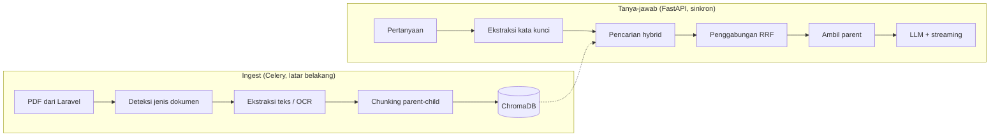

# Arsitektur RAG — AI Microservice (sebagaimana terimplementasi)

Dokumen ini menjelaskan cara kerja pencarian dan penyusunan jawaban di
`python-ai/` **seperti yang benar-benar ada di kode**, bukan seperti yang
direncanakan di awal. Rujukan `berkas:baris` disertakan supaya bisa
ditelusuri langsung.

Dokumen [`02-arsitektur_sistem_agentic_copilot.md`](02-arsitektur_sistem_agentic_copilot.md)
menjelaskan arsitektur ketiga komponen secara keseluruhan; yang ini khusus
bagian AI-nya.

## 0. Lingkup: dokumen generik, bukan satu jenis dokumen

Layanan ini menerima **dokumen apa pun yang diunggah admin** lewat panel web —
peraturan, panduan, manual, notulen, formulir. Tidak ada satu jenis dokumen pun
yang diistimewakan, dan tidak boleh ada nama dokumen, judul, atau istilah khas
satu instansi yang dipatok di dalam kode.

Itu bukan cita-cita, melainkan syarat rancangan yang berulang kali menentukan
keputusan teknis di dokumen ini. Tiga contohnya:

- Judul dokumen **diturunkan dari isi dokumen itu sendiri**, bukan ditulis di
  kode (§2.4). Judul yang dipatok akan menempel keliru ke setiap dokumen baru.
- Kata pembeda antar bagian **diturunkan dari label yang benar-benar ada di
  korpus** (§3.8), sehingga mekanisme yang sama bekerja pada dokumen perizinan,
  kepegawaian, atau apa pun tanpa satu baris kode berubah.
- Penjaga yang hanya masuk akal untuk satu format dokumen **dibatasi secara
  eksplisit** agar tidak menolak pertanyaan yang sah pada dokumen lain (§3.6).

**Tentang contoh-contoh di dokumen ini.** Seluruh angka dan kasus nyata di sini
berasal dari satu korpus percobaan: berkas SOP Diskominfotik Banda Aceh
(171 halaman, 170 di antaranya pindaian; selama pengembangan dipakai petikan
10 halaman). Korpus itu dipilih karena tersedia dan karena bentuknya sulit —
tabel bagan alir hasil pindai adalah kasus terburuk yang realistis. **Ia contoh
uji, bukan sasaran.** Setiap kali sebuah mekanisme dijelaskan dengan contoh SOP,
yang perlu dibaca adalah mekanismenya; contohnya kebetulan.

## 0.1 Tumpukan teknologi yang benar-benar dipakai

| Peran | Teknologi | Catatan |
|---|---|---|
| Kerangka API | FastAPI | streaming SSE + endpoint non-streaming |
| Penyusun jawaban | Ollama — `qwen2.5:7b` | model **teks**, `temperature=0`, `reasoning=False` |
| OCR halaman pindai | Ollama — `qwen2.5vl` | model **vision** lewat REST `/api/generate`. **Bukan** Tesseract |
| Embedding | `BAAI/bge-m3` | via `sentence-transformers` |
| Basis data vektor | ChromaDB | koleksi `documents`, jarak cosine |
| Pencarian kata | `rank_bm25` | digabung dengan vektor lewat RRF |
| Antrean ingest | Celery + Redis | ingest berjalan di proses terpisah |
| Status dokumen | MySQL | dibaca panel admin Laravel |
| Penilai evaluasi | DeepSeek (RAGAS) + penilai fakta deterministik | model penjawab tidak menilai dirinya sendiri |

Dua model Ollama dipakai **terpisah dan disengaja**: `qwen2.5vl` multimodal
untuk membaca gambar halaman, `qwen2.5:7b` teks-saja untuk menyusun jawaban.
Memakai satu model multimodal untuk keduanya pernah dicoba dan membuat jawaban
chat jauh lebih lambat tanpa keuntungan apa pun.

---

## 1. Dua alur besar



Keduanya berjalan di **proses yang terpisah**: ingest di pekerja Celery,
tanya-jawab di server FastAPI. Keduanya membaca direktori ChromaDB yang sama.

---

## 2. Ingest

### 2.1 Ekstraksi teks

`document_processor.detect_document_type()` menentukan apakah halaman berisi
teks yang bisa dibaca langsung atau hasil pindai. Halaman pindai dikirim ke
model vision Ollama lewat REST API `/api/generate`
(`pdf_processor.vision_extract_general()`) — **bukan** ke mesin OCR terpisah seperti Tesseract.

**Keluaran model vision tidak deterministik.** Halaman yang sama bisa
menghasilkan isi berbeda tiap kali di-OCR, dan bagian yang terjatuh tidak
menimbulkan galat apa pun. Kasus nyatanya: baris `Nama SOP:` hilang dari
halaman SOP Renstra, sehingga halaman itu tidak mendapat label
`[Konteks: SOP ...]` (bagian 2.4) dan tidak pernah ditemukan ketika ditanya
memakai nama prosedurnya — dokumen tetap ter-ingest, jawabannya saja yang
selalu "tidak ditemukan".

Penjaganya ada di `_ocr_dengan_penjaga`: halaman yang memuat `Nomor SOP`
tetapi kehilangan `Nama SOP` di-OCR ulang sampai dua kali, dan bila tetap
gagal, dicatat sebagai `ERROR` alih-alih lolos diam-diam.

Penjaga itu **membatasi dirinya sendiri**, dan itu disengaja: syaratnya
`Nomor SOP` ADA tetapi `Nama SOP` hilang. Halaman dokumen umum tidak memuat
`Nomor SOP` sama sekali, jadi langsung lolos pada percobaan pertama — tidak ada
OCR ulang, tidak ada yang ditandai gagal.

#### Prompt OCR: dasar generik, petunjuk format opsional

Prompt dibagi dua (`pdf_processor.py`):

| Bagian | Kapan dipakai | Isinya |
|---|---|---|
| `_PROMPT_OCR_DASAR` | **selalu** | Salin seluruh teks apa adanya, pertahankan urutan baca, **pertahankan penanda daftar persis seperti tertulis**, jangan pakai tabel Markdown, sel kosong dibiarkan kosong |
| `_PETUNJUK_FORMULIR_SOP` | hanya bila terdeteksi | Struktur kepala formulir dan format langkah prosedur, termasuk permintaan eksplisit menyalin `Nama SOP` |

Sebelumnya seluruh isi kolom kanan ditempelkan ke **setiap** halaman dokumen
apa pun. Itu keliru untuk platform yang menerima unggahan generik: memberi tahu
model bahwa *"dokumen ini terdiri dari HEADER dan TABEL PROSEDUR"* membuatnya
mencari struktur yang tidak ada pada notulen, surat, atau laporan — dan model
yang diminta mencari sesuatu cenderung menemukannya walau tidak ada.

Deteksinya **diturunkan dari dokumen itu sendiri**, bukan dari nama berkas atau
setelan. `_terlihat_formulir_sop()` mensyaratkan **dua** penanda dari
`nomor sop`, `nama sop`, `uraian prosedur`, `mutu baku`. Satu saja tidak cukup:
kata "nama SOP" bisa muncul di notulen mana pun yang kebetulan membahas SOP,
sedangkan kombinasinya praktis hanya ada pada formulirnya.

Alurnya: halaman pindai pertama dibaca dengan prompt dasar; bila hasilnya
menunjukkan formulir, halaman itu dibaca ulang **sekali** dengan petunjuknya dan
halaman berikutnya langsung memakainya. Ongkosnya paling banyak satu panggilan
tambahan per dokumen, dan dokumen umum tidak pernah menyentuh jalur ini.

#### Penanda daftar yang rontok saat OCR

Daftar resmi Indonesia yang melebihi 26 item memakai huruf yang **diulang**:
`a…z`, lalu `aa…zz`, lalu `aaa…zzz`. Model vision tidak menghitung
pengulangan itu — ia menebak jumlah yang terlihat wajar.

Terukur pada korpus ini: halaman yang seharusnya berpenanda `hhh, iii, jjj,
… vvv` terbaca `h, iii, jj, … vv`. Satu utuh, satu rontok dua huruf, tiga
belas rontok satu. Tidak beraturan — tanda tebakan, bukan aturan. Halaman
sebelumnya yang juga memakai huruf rangkap tiga (`aaa…ggg`) justru terbaca
benar seluruhnya.

Akibatnya jauh lebih besar daripada penanda yang jelek. Penanda yang memendek
terbaca sebagai urutan **mundur**, sehingga daftar 74 item terpecah di batas
halaman menjadi 59 + 15 — lalu yang 59 menang karena lebih panjang, dan
jawaban berhenti di item ke-59 dengan penuh keyakinan. Tidak ada galat yang
muncul; hanya jawaban yang diam-diam kurang.

Ditangani dua lapis:

1. **Saat ingest** (`perbaiki_penanda_daftar`) — penandanya dinormalkan
   kembali. Deterministik, bukan menebak: penerus `ggg` pasti `hhh`. Isi
   itemnya tidak disentuh sama sekali. Dijalankan setelah SELURUH halaman
   terkumpul, karena penanda pertama sebuah halaman hanya bisa disimpulkan
   dari penanda terakhir halaman sebelumnya.
2. **Saat membaca** (`_penanda_maju`) — runtun tetap tersambung bila hurufnya
   maju tepat satu langkah walau panjangnya memendek. Lapis ini yang membuat
   korpus yang **sudah terlanjur tersimpan** tetap terjawab benar tanpa
   menunggu ingest ulang.

Keduanya menolak menyentuh daftar yang memang berbeda: perbaikan hanya
berlaku bila hurufnya sama dengan yang diharapkan dan runtun sebelumnya sudah
cukup panjang. Penanda yang bukan huruf-diulang (`NIP.`, `iv.`) memutus
runtun — tanpa syarat itu, `NIP.196911172001121002` di halaman pengesahan
sempat tercatut sebagai item ke-75.

### 2.2 Chunking parent-child

Satu halaman menghasilkan dua tingkat potongan (`embedding_service.chunk_text_hierarchical()`):

| Tingkat | Ukuran | Tumpang tindih | Perannya |
|---|---|---|---|
| **Parent** | 1.500 karakter | 200 | Dikirim ke LLM sebagai konteks yang utuh |
| **Child** | 300 karakter | 50 | Di-embed sebagai indeks pencarian |

Pencarian hanya menyentuh **child**; yang dibaca LLM selalu **parent**.

**Alasannya — dilusi vektor.** Satu halaman SOP bisa memuat 28–59 item.
Bila seluruh halaman dipadatkan jadi satu vektor, satu item hanya menyumbang
sekitar 1/59 bagian dari makna vektor itu dan sinyalnya tenggelam. Potongan
child yang kecil membuat satu item menjadi porsi dominan dari vektornya.

Pengukuran pada 5 kueri terhadap data asli:

| Kueri | Halaman benar | Peringkat via vektor halaman | Peringkat via child |
|---|---|---|---|
| Pelaksanaan Kegiatan Podcast | 6 | 1 | 1 |
| Layanan VPN | 5 | 1 (skor 0,416) | 1 (skor **0,651**) |
| **Pengajuan Cuti Pegawai** | 4 | **5** ❌ | **1** ✓ |
| Kunjungan BA Command Centre | 6 | 3 | 2 |
| Layanan Hosting | 5 | 1 | 1 |

### 2.3 Penanganan halaman berisi daftar

Halaman dengan **≥10 item beruntun** (`_LIST_ITEM_THRESHOLD`) diperlakukan
khusus (`_LIST_ITEM_THRESHOLD`, `embedding_service.py`):

- Bila panjangnya ≤6.000 karakter (`_LIST_BLOCK_HARD_CAP`), halaman disimpan
  **utuh sebagai satu parent** supaya tidak ada item yang terpisah dari
  daftarnya.
- Bila lebih panjang, pemecahan dilakukan **di batas item**, bukan di tengah
  karakter (`embedding_service._split_list_preserving_items()`).

Aturan batas-item ini juga dipakai untuk child (`embedding_service._split_list_preserving_items()`).
Efeknya pada dokumen uji: jumlah child turun dari 82 menjadi 65 — lebih
sedikit, tetapi setiap potongan kini mewakili satu item secara utuh.

### 2.4 Konteks yang disuntikkan ke tiap potongan

Setiap potongan diawali prefix (`embedding_service.chunk_text_hierarchical()`):

```
[Halaman 4]
[Topik Utama: <judul dokumen>]
[Konteks: SOP <nama SOP>]
```

Judul dokumen **diturunkan dari isi dokumen itu sendiri** lewat
`derive_document_title()`, bukan dipatok di kode. Ini syarat wajib agar
platform bisa menampung dokumen dari OPD lain — judul yang dipatok akan
menempel keliru ke setiap dokumen baru dan mencemari hasil pencariannya.

> **Label ini bermata dua.** Ia disuntikkan ke setiap **child**, sehingga ikut
> di-embed dan menarik halaman bersangkutan ke pertanyaan mana pun yang
> menyebut kata di dalamnya. Terukur pada pertanyaan tentang dasar hukum
> Keputusan: kemiripan halaman SOP Renstra naik dari 0,5790 menjadi 0,6096
> hanya karena labelnya, melewati halaman yang benar (0,5982). Label itulah
> yang membuat halaman SOP ditemukan saat ditanya namanya — dan yang sama juga
> membuatnya menyerobot pertanyaan lain. Jalur daftar terprogram (bagian 3.8)
> yang meredam akibatnya.

### 2.5 Penyimpanan

ChromaDB, koleksi `documents`, jarak **cosine**
(`embedding_service.py:84`). Metadata tiap potongan memuat
`document_id`, `page_number`, `chunk_index`, `chunk_type`, dan `parent_id`.

---

## 2.1 Ekstraksi bertahap: jeda, lanjut, dan gerbang koreksi

Bab 2 di atas menjelaskan ingest sekali jalan — `extract_text()` mengerjakan
seluruh dokumen dalam satu panggilan. Untuk dokumen pindaian ratusan halaman
itu berjam-jam, dan proses yang mati di halaman 168 membuang seluruh
pekerjaannya.

Alur bertahap memecah pekerjaan itu pada dua batas yang berbeda sifatnya:

```
unggah -> ekstraksi (bisa dijeda) -> KOREKSI -> pratinjau -> SIMPAN -> selesai
                                       ^                       ^
                                  menunggu orang          menunggu orang
```

Tidak ada tahap yang berjalan otomatis setelah tahap sebelumnya selesai.

### Tiga keputusan yang menopangnya

**Simpan tiap halaman SEBELUM lanjut.** Kemajuan yang sudah dibayar dengan
waktu OCR tidak boleh hilang karena apa pun. Dengan begitu jeda, mati listrik,
dan worker yang dibunuh menjadi setara: yang tersimpan tetap tersimpan.

**Jeda itu kooperatif, bukan pembunuhan proses.** Satu panggilan model vision
berlangsung 20–60 detik dan tidak bisa dipotong di tengah tanpa menyisakan
halaman separuh. Benderanya karena itu diperiksa **di antara halaman** —
halaman yang sedang berjalan diselesaikan dan disimpan dulu, baru berhenti.

Urutannya penting dan mudah terbalik: memeriksa jeda **sebelum** menyimpan
berarti membuang halaman yang baru saja dibayar dengan puluhan detik OCR.

**Sinyal jeda lewat penyimpanan bersama, bukan variabel di memori.**
Permintaan jeda datang dari permintaan web di proses lain — bukan proses yang
sedang meng-OCR. Bendera di memori tidak akan pernah terlihat worker. Karena
MySQL sudah dipakai bersama Laravel, di situlah benderanya.

### Yang sengaja TIDAK dilakukan

**Pemotongan dan embedding tidak dijalankan per halaman.** Dua mekanisme di
layanan ini melintasi batas halaman:

- `perbaiki_penanda_daftar()` memulihkan penanda daftar dengan melihat halaman
  sebelumnya — penerus `ggg` pasti `hhh`
- pewarisan konteks membuat halaman lanjutan memakai label halaman kepalanya

Memotong halaman 4 sebelum halaman 3 ada berarti keduanya kehilangan
pendahulunya. Pemotongan karena itu menunggu **seluruh** halaman terkumpul,
dan `perbaiki_penanda_daftar()` berjalan tepat sebelum status berpindah ke
`menunggu_koreksi`.

### Catatan format yang dibawa antar halaman

Saat model membaca halaman kepala sebuah formulir, ia menyadari bentuk
dokumennya dan menyimpan catatan format. Halaman lanjutan memakai catatan itu,
dan karena itu tahu cara menulis tabel prosedur dengan benar.

`ekstrak_satu_halaman()` menerima catatan itu sebagai argumen dan
mengembalikannya bersama teksnya. Pemanggil **wajib** menyimpan nilai
kembaliannya dan menyerahkannya lagi pada panggilan berikutnya.

Melewatkannya **tidak menimbulkan galat apa pun**: halamannya tetap
terekstrak, tetap tersimpan, kemajuan tetap bertambah. Yang berubah hanya
isinya — aturan format tabel hilang, `Waktu` dan `Output` menyatu — dan itu
baru ketahuan berhari-hari kemudian lewat jawaban yang keliru.

Karena itu catatannya ikut **disimpan** ke kolom `petunjuk_format`, bukan
sekadar dioper antar panggilan: worker yang dijalankan ulang setelah jeda
memulai dari memori kosong.

Agar kedua jalur tidak menyimpang, logika per halaman ditulis **sekali** di
`_ekstrak_halaman()` dan dipakai bersama oleh `extract_text()` maupun
`ekstrak_satu_halaman()`.

### Keadaan

| Status | Artinya |
|---|---|
| `antre` | Tugas sudah masuk Celery, belum mulai |
| `berjalan` | OCR sedang mengerjakan halaman |
| `jeda` | Berhenti di batas halaman; kemajuan aman |
| `menunggu_koreksi` | Semua halaman terekstrak, menunggu admin |
| `selesai` | Vektor sudah masuk ChromaDB |
| `gagal` | Ada halaman yang tidak terbaca; lihat kolom `pesan` |

`menunggu_koreksi` adalah keadaan **diam**: sistem tidak mengerjakan apa pun.
Hasil OCR dokumen pindaian tidak layak masuk korpus tanpa diperiksa mata
manusia — bab 8 mencatat empat kali kesalahan ekstraksi yang hanya ketahuan
saat diadu ke citra halamannya.

### Kenapa pemotongan bukan tombol tersendiri

Pemotongan dan embedding berbeda sifat:

| | Pemotongan | Embedding |
|---|---|---|
| Biaya | milidetik | menit |
| Sifat | fungsi murni: teks sama → potongan sama | menulis ke ChromaDB |

Pemotongan tidak punya akibat apa pun, jadi ia dijalankan otomatis sebagai
**pratinjau** yang bisa dilihat admin. Yang dijaga tombol adalah embedding —
satu-satunya langkah yang mahal sekaligus mengganti isi korpus.

Potongannya dihitung ulang tepat saat tombol ditekan, bukan diambil dari
pratinjau yang mungkin dilihat berjam-jam sebelumnya. Dengan begitu mustahil
ada potongan basi — dibuat dari teks versi lama, tetap tampak sah — yang masuk
korpus sementara layar menampilkan teks yang lain.

### Triase halaman yang perlu diperiksa

Memeriksa ratusan halaman satu per satu terasa mustahil dan pada akhirnya
dilewati — yang sama saja dengan tidak punya tahap koreksi. Karena itu sistem
menandai halaman yang mencurigakan lebih dulu, lewat
`_header_sop_tidak_lengkap()`: halaman yang memuat `Nomor SOP` tetapi
kehilangan `Nama SOP` atau baris `NIP.`.

`_bagian_kepala_hilang()` menyebutkan bagian mana yang hilang, sehingga
pesannya bisa ditindaklanjuti alih-alih sekadar berbunyi "cacat".

### Citra halaman untuk editor koreksi

`render_halaman()` merender satu halaman jadi JPEG saat diminta — 20–120
milidetik per halaman, jadi tidak ada gunanya menyiapkan ratusan gambar lebih
dulu. JPEG dipilih karena halaman pindaian bersifat fotografis: PNG tiga kali
lebih besar untuk hasil yang terlihat sama.

Terukur pada halaman lanskap 936×612 pt:

| Zoom | Piksel | PNG | JPEG q80 | Render |
|---|---|---|---|---|
| 1,5× | 1404×918 | 338 KB | 115 KB | 0,04 s |
| **2×** | 1872×1224 | 577 KB | **186 KB** | 0,02 s |
| 3× | 2808×1836 | 1242 KB | 351 KB | 0,12 s |
| 4× | 3744×2448 | 2084 KB | 545 KB | 0,10 s |

**Zoom bawaannya sama persis dengan yang dibaca model OCR** — keduanya memakai
konstanta `ZOOM_OCR`. Itu syarat, bukan kebetulan: bila korektor melihat
gambar lebih tajam daripada yang dibaca model, ia akan memperbaiki teks yang
mustahil terbaca mesin lalu mengira masalahnya selesai, padahal itu pertanda
resolusi render yang perlu dinaikkan.

Dengan resolusi yang sama, penyebabnya langsung terbaca:

- korektor bisa baca, model tidak → **kegagalan model**
- korektor juga tidak bisa baca → **render kurang tajam**

### Berkas yang terlibat

| Berkas | Isinya |
|---|---|
| `app/services/ekstraksi_bertahap.py` | alur jeda/lanjut, protokol penyimpanan, `PenyimpananMemori`, `PenyimpananMySQL` |
| `app/tasks/ekstraksi.py` | dua tugas Celery: ekstraksi bertahap, lalu potong & embed |
| `app/routers/ekstraksi.py` | delapan endpoint kendali alur |
| `pdf_processor.ekstrak_satu_halaman()` | ekstraksi satu halaman yang membawa catatan format |
| `pdf_processor.render_halaman()` | citra halaman untuk editor |

Kontrak HTTP-nya seluruhnya ada di
[`04-api_spec_agentic_copilot.md`](04-api_spec_agentic_copilot.md) bagian 1.

### Yang belum terbukti

Seluruh uji alur bertahap memakai penyimpanan tiruan di memori. Query
MySQL-nya — `ON DUPLICATE KEY UPDATE` dan subquery penghitung
`halaman_selesai` — **belum pernah dijalankan lawan MySQL sungguhan**, dan
kedua tabelnya belum dibuat. Yang terjamin sekarang adalah bentuk antarmuka
dan alurnya, bukan kebenaran SQL-nya.

---

## 3. Tanya-jawab

### 3.1 Ekstraksi kata kunci

Sebelum mencari, pertanyaan diringkas jadi frasa kata kunci oleh LLM
(`rag_service.py:1214`). Tujuannya membuang kalimat pengantar dan nomor
peraturan yang mengaburkan pencarian vektor.

**Pertanyaan asli ikut dicari, tidak digantikan.** Ekstraksi kata kunci memang
membuang kalimat pengantar yang mengaburkan, tetapi kadang ikut membuang kata
pembatas yang justru menentukan — misalnya "tetap" pada "cuti pegawai tetap".
Bila hanya kata kuncinya yang dicari, pembatas itu hilang dan dua daftar
berbeda dalam satu dokumen tercampur. Dengan keduanya dicari, RRF yang
memutuskan mana yang lebih relevan, bukan hasil ekstraksi kata kunci.

Bila kata kunci hasil ekstraksi ternyata sama persis dengan pertanyaan aslinya,
kueri kedua tidak ditambahkan — tidak ada gunanya mencari hal yang sama dua kali.

### 3.2 Deteksi pertanyaan bertipe daftar

`_is_list_query()` (`rag_service.py`) mencocokkan kata seperti
*"apa saja"*, *"sebutkan"*, *"daftar"*. Bila cocok, jatah diperlonggar:

| Parameter | Normal | Pertanyaan daftar |
|---|---|---|
| Hasil per kueri (`_TOP_K`) | 8 | 32 |
| Potongan ke LLM | 10 | 20 |

> **Catatan.** `_TOP_K` sempat bernilai 20 — dengan pengali empat, satu
> pertanyaan daftar meminta 80 hasil sementara korpus percobaan hanya punya 75
> vektor. Akibatnya seluruh korpus dikirim ke LLM setiap kali dan penyaringan
> tidak terjadi sama sekali; satu jawaban terukur memakan 495 detik. Angka 8
> menurunkan panjang konteks, yang merupakan penentu utama waktu *prompt eval*.

Jendela konteks LLM **tidak** ikut dipatok di sini — ia dihitung dari panjang
konteks yang benar-benar terkumpul (bagian 3.9).

Ditambah dua **anchor query** yang dibentuk dari kata kunci pengguna
(`rag_service.py:319`) untuk menemukan halaman yang memuat enumerasi.
Anchor ini sengaja generik — versi sebelumnya memakai frasa yang dipatok ke
satu dokumen tertentu dan menyeret halaman dokumen itu masuk ke pertanyaan
tentang dokumen lain.

### 3.3 Pencarian hybrid

Dua pencarian berjalan berdampingan untuk tiap kueri:

| Jalur | Menangkap | Sumber |
|---|---|---|
| **Vektor** | Kemiripan makna | ChromaDB, `bge-m3` |
| **BM25** | Kecocokan kata harfiah | `rank_bm25`, ambang skor 0,1 |

Indeks BM25 dibangun **satu kali** lalu dipakai ulang
(`rag_service.py:168`). Sebelumnya seluruh korpus ditarik dan ditokenisasi
ulang pada setiap pertanyaan — biaya yang tumbuh sebanding dengan besar
korpus dan tertambahkan ke tiap kueri.

Kesahihan indeks ditentukan **dua** penanda:

| Penanda | Menangkap |
|---|---|
| `collection.count()` | Penambahan atau penghapusan vektor |
| `data/chromadb/corpus_version.txt` | Perubahan yang **tidak** mengubah jumlah vektor, dan perubahan yang terjadi di proses lain |

Penanda kedua diperlukan karena ingest berjalan di pekerja Celery sedangkan
cache hidup di server FastAPI: variabel level modul tidak menyeberangi batas
proses, jadi memanggil invalidasi dari Celery sama sekali tidak menyentuh cache
di server API. Sebelum ada penanda ini, menimpa dokumen dengan jumlah potongan
yang kebetulan sama membuat server terus menyajikan teks dokumen versi lama
sampai di-restart.

### 3.4 Penggabungan Reciprocal Rank Fusion

Kedua daftar hasil digabung berdasarkan **peringkat**, bukan skor mentah
(`rag_service.py:119`):

```
skor(potongan) = Σ  1 / (k + peringkat + 1)          k = 60
```

RRF dipilih karena skor vektor dan skor BM25 tidak sebanding skalanya.
Pendekatan sebelumnya memberi BM25 nilai jarak tetap `0,001`, yang membuatnya
selalu menang atas pencarian vektor meski relevansinya lemah.

### 3.5 Dari child ke parent

Child dengan peringkat tertinggi ditelusuri ke `parent_id`-nya
(`rag_service.py:418`). Parent unik diurutkan berdasarkan skor terbaik
child-nya, dipotong sesuai jatah, lalu **diurutkan ulang mengikuti urutan
dokumen** (`page_number`, lalu `chunk_index`) sebelum dikirim ke LLM — supaya
model membacanya dalam urutan yang sama seperti dokumen aslinya.

### 3.6 Tiga penjaga sebelum jawaban disusun LLM

> Perlu diluruskan lebih dulu: ketiga penjaga ini **tidak** membuat Ollama
> bebas dari panggilan. Ekstraksi kata kunci (§3.1) sudah memanggil LLM satu
> kali sebelum penjaga mana pun sempat jalan. Yang dihemat penjaga adalah
> panggilan **kedua** — penyusunan jawaban — yang jauh lebih mahal karena
> memuat seluruh konteks, bukan cuma satu kalimat pertanyaan.

1. **Konteks kosong** → langsung menjawab *"tidak ditemukan"*, LLM tidak
   dipanggil (`rag_service.py:1403`).
2. **Pertanyaan meminta prosedur, tetapi konteks hanya memuat daftar nama
   SOP** → dijawab langsung tanpa LLM (`rag_service.py:1426`). Tanpa penjaga
   ini, model cenderung mengarang langkah-langkah yang tidak ada di dokumen.

   Penjaga kedua **hanya berlaku untuk dokumen berformat formulir SOP**
   (`_context_is_sop_document`). Ia mengenali "rincian prosedur" lewat nama
   kolom formulir SOP pemerintah — `Dasar Hukum:`, `Kualifikasi Pelaksana:`,
   `Pelaksana:`, dan seterusnya. Dokumen di luar format itu tidak punya kolom
   tersebut, sehingga tanpa pembatas ini **setiap** pertanyaan "bagaimana cara"
   pada panduan, peraturan, atau manual akan ditolak walau jawabannya jelas ada
   di konteks — dan pesan penolakannya pun menyebut "SOP" untuk dokumen yang
   bukan SOP. Syarat mutlak agar platform bisa menampung dokumen OPD lain.

3. **Pertanyaan menyebut entitas bernomor yang tidak ada** — "Diktum
   KEEMPAT" pada keputusan yang hanya punya tiga diktum, atau "langkah
   ke-11" pada prosedur bersepuluh langkah → ditolak tanpa memanggil LLM
   (`_entitas_tak_ada_di_konteks`).

   Penjaga ini dipasang **paling awal**, sebelum jalur daftar terprogram di
   §3.8. Alasannya jalur itu menjawab tanpa melibatkan LLM sama sekali,
   sehingga tidak ada tahap lain yang berkesempatan menyadari premisnya
   palsu: ditanya isi Diktum KEEMPAT, sistem pernah memuntahkan 74 SOP milik
   Diktum KEDUA dengan penuh percaya diri.

   Ia sengaja memilih **diam** bila konteksnya tidak cukup terstruktur
   (kurang dari tiga item bernomor). Menolak menjawab secara keliru jauh
   lebih merugikan daripada melewatkan satu premis palsu.

### 3.7 Tabel perbandingan

Untuk pertanyaan bernada perbandingan, sistem menyusun tabel selisih antar
**bagian dokumen** secara terprogram lalu menyisipkannya di awal konteks
(`rag_service.py:1105`). LLM lokal lemah dalam penalaran perbandingan; tabel
ini memberinya jawaban yang sudah setengah jadi.

Bagian yang dibandingkan dikenali dari label `[Konteks: …]` hasil ingest
(§2.4) — jadi mekanismenya berlaku untuk pembanding apa pun yang labelnya
terbentuk, bukan khusus formulir SOP.

### 3.8 Daftar panjang disusun terprogram, bukan oleh LLM

Untuk pertanyaan yang meminta daftar **utuh** ("sebutkan seluruhnya", "berapa
total"), daftarnya diambil dari konteks secara terprogram dan **dikirim apa
adanya** — LLM tidak dilibatkan sama sekali di jalur ini.

Alasannya terukur. Diminta *"Berapa total SOP … **dan sebutkan seluruhnya**?"*
atas daftar 74 item yang seluruhnya ada di konteks, `qwen2.5:7b` berhenti di
item ke-46 — tiga kali berturut-turut, di item yang persis sama, pada
`temperature=0`.

| Upaya | Item ditulis | Jumlah disebut |
|---|---|---|
| Pertanyaan asli, apa adanya (3×) | 46 | 46 |
| `num_predict=8192` eksplisit | 46 | 46 |
| Instruksi "salin seluruhnya" | **20** ⬇ | — |
| Daftar jadi disisipkan ke konteks | **31** ⬇ | 26 |
| **Pertanyaan tanpa permintaan jumlah** | **73** | tidak menyebut |
| **Dijawab terprogram** | **74** ✓ | **74** ✓ |

**Pemicunya bukan panjang daftar, melainkan permintaan jumlahnya.** Konteks dan
model yang sama, hanya kalimat tanyanya diubah: *"Sebutkan seluruh SOP yang
tercantum dalam Diktum KEDUA"* menghasilkan 73 item — praktis lengkap.

Bentuk jawabannya menjelaskan sebabnya: model membuka dengan *"…tercantum
sebanyak **46** SOP. Berikut daftar lengkapnya:"* — **menyebut angka lebih
dulu**, lalu berhenti tepat di angka itu. Pada run lain ia menyebut 41 dan
berhenti di 41. Angka yang disebut selalu sama dengan yang ditulis: ia menebak
jumlah di awal, lalu patuh pada tebakannya sendiri.

Bukan retrieval (74/74 hadir), bukan jendela konteks (9.216 dialokasikan,
~6.300 terpakai), bukan batas keluaran (`num_predict=8192` memberi hasil
identik), bukan keacakan (tiga kali sama persis).

Dua baris yang menurun juga penting: **menambah teks ke prompt maupun ke
konteks justru memperburuk.** Instruksi tambahan dan daftar yang disodorkan
sama-sama ikut berebut perhatian. Karena itu jalur ini melewati model
sepenuhnya — jumlahnya dihitung dari dokumen, bukan ditebak.

Kalimat pengantar jawaban diambil dari teks tepat sebelum daftar di dokumen —
di situ biasanya tertulis daftar apa ini — sehingga jawabannya tetap
menjelaskan diri tanpa satu kata pun yang dipatok di kode.

**Daftar dikenali dari kesinambungan urutan penanda, bukan gayanya.** Satu
konteks kerap memuat beberapa daftar angka yang tak berhubungan — dasar hukum,
langkah prosedur, peralatan. Mengelompokkannya berdasarkan gaya penanda
menyatukan ketiganya menjadi satu daftar palsu; yang memisahkan adalah
penandanya berhenti maju. Skema `a … z, aa … zz, aaa …` ikut dikenali karena
itulah cara dokumen resmi Indonesia menomori daftar melebihi 26 item.

Daftar mana yang dipakai ditentukan **kecocokan dengan pertanyaan**, bukan
panjangnya: pertanyaan tentang dasar hukum harus mendapat daftar dasar hukum
meski daftar SOP di dokumen yang sama jauh lebih panjang. Penilaiannya memakai
kata dari pertanyaan yang muncul di teks pengantar daftar.

Tiga hal membuat pemilihannya bisa diandalkan:

**Item yang menyatu dengan judulnya ikut terbaca.** Dokumen resmi menulis
`Mengingat : 1. Undang-Undang...` dalam satu baris. Bila item pertama tidak
terdeteksi, runtun dimulai dari item **kedua** dan kata pembeda di judulnya
hilang dari penilaian — persis yang membuat pertanyaan tentang dasar hukum
mengambil daftar milik SOP lain.

**Kata dibobot menurut kelangkaan.** Menghitung tiap kata sama berat membuat
kata umum menenggelamkan kata penentu: "sop", "dasar", dan "hukum" muncul di
hampir semua daftar sehingga tidak membedakan apa pun, sedangkan "Mengingat" —
yang hanya ada di satu daftar — justru kalah suara. Terukur: dengan bobot rata
skornya 6 lawan 7 (salah pilih); dengan bobot kelangkaan, daftar yang benar
menang.

**Penilaian mencakup rentang penuh daftar,** bukan hanya judul itemnya. Kata
pembeda pertanyaan seperti "pelaksana" dan "waktu" berada di baris rincian di
antara item.

Dua pembatas menjaga agar pertanyaan yang sudah benar tidak ikut terganggu:

| Syarat | Alasan |
|---|---|
| Pertanyaan meminta daftar **utuh** | "Sebutkan 5 contoh" tidak butuh 74 item disodorkan. Dicocokkan di awal kata, sehingga "per**lengkap**an" tidak ikut terjaring |
| Daftar **tidak bertingkat** | Daftar yang tiap itemnya punya baris rincian (`- Pelaksana:`, `- Waktu:`) diserahkan ke LLM — menyajikannya datar justru membuang bagian yang ditanyakan |
| Daftar terpilih **≥ 10 item** | Di bawah itu model masih andal |

**Memilih daftar yang benar ketika dua SOP nyaris kembar.** Dokumen ini
memuat SOP Renstra dan SOP Renja yang daftar peralatannya sama persis pada
enam butir pertama. Kata pertanyaan tidak membedakan keduanya — halaman Renja
pun menyebut "Renstra" beberapa kali akibat salin-tempel di dokumen aslinya,
bahkan pada bagian Kualifikasi Pelaksana yang identik kata per kata.

Akibatnya pemilihan jatuh ke pemutus terakhir, yaitu daftar yang lebih
panjang — dan pertanyaan tentang peralatan Renstra (9 butir) dijawab dengan
daftar Renja (10 butir).

Pembedanya adalah label `[Konteks: SOP …]` hasil ekstraksi Nama SOP saat
ingest (§2.4) — label yang sama yang dulu memperbaiki pertanyaan tentang
Nomor SOP Renstra.

Kata pembedanya **diturunkan dari label yang benar-benar ada di korpus**,
bukan dari daftar nama yang dipatok di kode: kata yang dimiliki semua label
("sop", "penyusunan", "rencana") otomatis gugur karena tidak membedakan apa
pun, dan yang tersisa justru nama khas tiap bagian. Untuk korpus ini hasilnya
`renstra/strategis/diskominfo` melawan `renja/kerja/diskominfotik`; untuk
dokumen perizinan hasilnya `bangunan/mendirikan` melawan `mikro/usaha` — tanpa
satu baris kode pun berubah.

Ini disengaja dan bukan sekadar kerapian. Mematok nama SOP di kode berarti
layanan hanya bekerja untuk satu dokumen tertentu, padahal kode yang sama
melayani seluruh dokumen yang di-ingest — persis masalah yang sudah
diidentifikasi pada prefix topik di §2.4.

Runtun yang berada di bawah label yang jelas bukan yang ditanya dibuang lebih
dulu (`_saring_menurut_label`).
Penyaringan itu **hanya aktif bila pertanyaan menyebut tepat satu nama SOP**.
Pertanyaan pembanding menyebut keduanya dan justru membutuhkan keduanya tetap
ada; menyaringnya akan merusak empat pertanyaan yang selama ini sudah
terjawab benar. Bila penyaringan menghabiskan seluruh calon, hasilnya
dibatalkan — penyaringnya yang keliru, bukan datanya.

Jawaban terprogram juga menyebut label sumbernya. Karena jalur ini tidak
melewati LLM, tidak ada tahap yang bisa menyadari salah ambil; menyebut
sumbernya membuat kekeliruan semacam itu terlihat oleh pembaca.

### 3.9 Penyusunan jawaban

`ChatOllama` dengan `temperature=0.0` dan `reasoning=False`. Konteks
ditempatkan di *system prompt*, pertanyaan di *human message*. Jawaban
dialirkan potongan demi potongan, lalu daftar sumber ditambahkan di akhir.

`reasoning=False` diperlukan karena model bermode *thinking* mengembalikan
konten kosong.

**Jendela konteks dihitung, bukan dipatok** (`_hitung_num_ctx`). Panjang
konteks dibagi 3 karakter/token, ditambah 2.048 token untuk jawaban,
dibulatkan ke kelipatan 1.024, lalu dibatasi `LLM_MAX_NUM_CTX` (bawaan 16.384)
dengan batas bawah 4.096.

Sebelumnya nilainya dipatok 16.384 untuk setiap pertanyaan daftar. Akibatnya
Ollama menyiapkan KV cache besar walau konteksnya pendek, dan pada mesin
ber-RAM terbatas alokasi itu **gagal** dengan
`ggml_backend_cpu_buffer_type_alloc_buffer: failed to allocate buffer` —
menjatuhkan seluruh permintaan. Konteks 19.342 karakter, misalnya, kini
mendapat 9.216 token alih-alih 16.384.

Bila alokasi tetap gagal, permintaan diulang otomatis dengan jendela separuhnya
sampai 4.096 (`_stream_jawaban`). Pengulangan hanya dilakukan bila kegagalan
terjadi **sebelum** satu potong pun terkirim — mengulang di tengah aliran akan
menduplikasi teks yang sudah terbaca pengguna.

---

## 4. Ringkasan konstanta

| Konstanta | Nilai | Berkas |
|---|---|---|
| `_PARENT_CHUNK_SIZE` / overlap | 1500 / 200 | `embedding_service.py` |
| `_CHILD_CHUNK_SIZE` / overlap | 300 / 50 | `embedding_service.py` |
| `_LIST_ITEM_THRESHOLD` | 10 | `embedding_service.py` |
| `_LIST_BLOCK_HARD_CAP` | 6000 | `embedding_service.py` |
| `_TOP_K` | 8 (×4 untuk daftar) | `rag_service.py` |
| `_MAX_CONTEXT_CHUNKS` | 10 (20 untuk daftar) | `rag_service.py` |
| `_RRF_K` | 60 | `rag_service.py` |
| `_BM25_MIN_SCORE` | 0.1 | `rag_service.py` |
| `_OLLAMA_TIMEOUT` | 300 detik | `rag_service.py` |
| `_OLLAMA_KEEP_ALIVE` | 30 menit | `rag_service.py` |
| `ZOOM_OCR` | 2.0 (144 DPI) | `pdf_processor.py` |
| `ZOOM_DIIZINKAN` | 1.5 / 2 / 3 / 4 | `pdf_processor.py` |
| `_MIN_TEXT_LENGTH` | 300 karakter | `pdf_processor.py` |
| `_OCR_ULANG_MAKS` | 2 pengulangan | `pdf_processor.py` |
| `_MIN_PORSI_PENANDA` | 0.50 | `embedding_service.py` |
| `_MAKS_KATA_PENANDA` | 4 kata | `embedding_service.py` |

---

## 5. Evaluasi

Mutu diukur dengan **dua alat yang sengaja gagal ke arah berlawanan**, plus
uji otomatis. Membaca ketiganya bersamaan jauh lebih berguna daripada
mempercayai satu angka.

| Alat | Berkas | Sifatnya |
|---|---|---|
| Penilai fakta deterministik | `evaluasi_sederhana.py` | Mencocokkan fakta wajib sebagai teks. Hasilnya **selalu sama bila diulang**, gratis, tanpa juri. Kelemahannya menilai **kata**, bukan makna |
| RAGAS | `test_ragas.py` | Juri LLM (bawaan **DeepSeek**). Memahami parafrase, tapi bisa gagal diam-diam |
| Uji otomatis | `test_rag_units.py`, `test_api_kontrak.py` | 147 uji, ~9 detik, tanpa satu pun layanan menyala |

Model penjawab **tidak pernah menilai dirinya sendiri**. Sebelumnya juri
bawaannya adalah model lokal yang sama dengan penjawabnya — cacat yang membuat
angka lamanya tidak bisa dipakai.

### 5.1 Dua dataset

`reference_eval_dataset.json` berisi 26 pertanyaan wajar, `reference_eval_lawan.json`
berisi 26 pertanyaan **lawan** — pertanyaan berpremis palsu, entitas yang tidak
ada, dan jebakan halaman tetangga. Dataset kedua yang menemukan hampir seluruh
kelemahan nyata; dataset pertama cenderung meluluskan.

### 5.2 Alat ukurnya sendiri harus diuji

Pelajaran yang paling mahal dari proyek ini: **penggaris bisa ikut rusak, dan
kerusakannya tidak terlihat.**

- Tiap butir dataset lawan menyimpan satu `jawaban_umpan`, yaitu jawaban SALAH
  yang khas. Uji otomatis memastikan kriteria **menjatuhkannya**. Uji satu arah
  saja — hanya memastikan jawaban benar lulus — pernah membiarkan empat kriteria
  terlalu longgar lolos tanpa ketahuan.
- Ground truth yang ditulis dari **hasil ekstraksi** mewarisi kesalahan
  ekstraksi. Ketika RAG menjawab dari korpus yang sama, jawaban keliru bertemu
  kriteria keliru dan dinilai **BENAR**. Terjadi empat kali, dan hanya ketahuan
  setelah dicocokkan ke citra halaman aslinya.

  **Aturannya sekarang: ground truth tentang tabel wajib ditulis dari halaman
  yang dirender, bukan dari ekstraksi**, dan `notes`-nya mencatat itu.

### 5.3 Membaca angka RAGAS dengan hati-hati

`factual_correctness` bernilai **tepat `0.0000`** bukan berarti jawabannya
salah total — itu tanda pemecahan klaim pulang kosong. Rantainya:
`verify_claims` mengembalikan array kosong secara diam-diam → `tp/fp/fn`
seluruhnya nol → `fbeta_score` secara eksplisit `return 0.0`. Tidak ada galat,
tidak ada `nan`.

Terukur: pada satu run 26 pertanyaan, **11 skor bernilai tepat nol** padahal
sebagian jawabannya cocok harfiah dengan ground truth-nya. Rata-rata tanpa
kesebelas itu 0,71, bukan 0,41 yang dilaporkan.

Metrik yang **tidak** menyentuh ground truth — `faithfulness` dan
`answer_relevancy` — kebal terhadap kegagalan ini dan karena itu paling layak
dipercaya.

---

## 6. Batasan yang diketahui

| Batasan | Letak | Akibat |
|---|---|---|
| Tabel perbandingan mengambil dua SOP pertama | rag_service.py:1145 | Bila konteks memuat 3+ SOP, pasangan yang dibandingkan ditentukan urutan retrieval |
| Kegagalan retrieval mengembalikan hasil kosong | rag_service.py:528 | Gangguan ChromaDB tidak terbedakan dari "memang tidak ada dokumen relevan" oleh pengguna. Jejak lengkapnya kini tercatat di log server |
| Deteksi pertanyaan daftar mencocokkan substring | rag_service.py:1264 | "semuanya" ikut memicu mode daftar, sehingga jatah chunk naik ke 20 untuk pertanyaan yang bukan permintaan daftar |
| Belum ada memori percakapan | rag_service.py:1364 | `session_id` hanya dipakai untuk log; tiap pertanyaan berdiri sendiri |
| Parent ikut di-embed padahal tak pernah dicari | `embed_and_store_hierarchical()` | Sekitar 46% waktu embedding saat ingest terpakai untuk vektor yang tidak digunakan jalur hierarkis |

Empat batasan yang tercatat di versi sebelumnya sudah tidak berlaku:
pertanyaan asli kini ikut dicari (3.1), invalidasi cache BM25 sudah
menyeberangi batas proses (3.3), jendela konteks dihitung sehingga tidak lagi
menjatuhkan permintaan karena gagal alokasi (3.9), dan halaman SOP yang
kehilangan judulnya kini terdeteksi lalu di-OCR ulang (2.1).

## 7. Kelemahan LLM lokal dan cara menghadapinya

Bukan soal retrieval — konteksnya sudah benar, modelnya yang kurang.

**Model menebak jumlah lalu mematuhi tebakannya** — sudah ditangani di bagian
3.8 dengan menjawab terprogram. Yang perlu diingat: pemicunya adalah pertanyaan
gabungan "berapa **dan** sebutkan", bukan panjang daftarnya. Pertanyaan yang
hanya meminta daftar tetap dijawab model dengan baik (73 dari 74 item), dan
"sebutkan beberapa layanan publikasi" pun wajar diserahkan ke model karena tidak
menuntut kelengkapan.

**Pelajaran yang lebih luas:** pada model sekecil ini, menambah teks ke prompt
untuk memperbaiki perilaku sering **memperburuknya**. Terukur dua kali pada
kasus yang sama — instruksi kelengkapan menurunkan hasil dari 46 ke 20, dan
menyisipkan daftar jadi ke konteks menurunkannya ke 31. Bila sebuah jawaban
bisa dipastikan tanpa model, jangan libatkan model.

**Catatan saat menilai mutu:** metrik berbasis klaim seperti
`factual_correctness` memberi nilai tinggi pada jawaban yang terpotong
(0,75–0,99 pada jawaban 46-dari-74), karena item yang ditulis memang semuanya
benar dan yang hilang tidak pernah menjadi klaim. Pencocokan fakta sederhana
menangkapnya lewat hal yang jauh lebih lugas — angka "74" tidak ada di jawaban.

---

## 8. Kelemahan ekstraksi yang terukur

Bab ini mencatat cacat yang **sudah terbukti**, bukan risiko teoretis. Semuanya
ditemukan dengan mencocokkan hasil ekstraksi ke **citra halaman aslinya** —
satu-satunya cara memeriksa yang bisa diandalkan.

**Kenapa bab ini ada di dokumen arsitektur.** Untuk dokumen hasil pindai, mutu
OCR menentukan segalanya di hilir. Tidak ada perbaikan retrieval, prompt, atau
penjaga yang bisa menyelamatkan teks yang sudah salah sejak awal — dan
kesalahannya tidak menimbulkan galat apa pun.

### 8.1 Tabel yang maknanya ada pada tata letak, bukan pada teks

Cacat terbesar, dan yang paling generik pelajarannya.

Pada formulir yang mengikuti template Permenpan 35/2012 — dipakai seluruh
instansi pemerintah Indonesia — kolom "Pelaksana" **tidak berisi teks sama
sekali**. Yang menandai pelaksana adalah **letak simbol bagan alir**: kotak di
kolom keempat berarti pelaksananya adalah pemilik kolom keempat.

Meminta model bahasa memipihkan itu jadi teks berarti memintanya mengerjakan
**geometri**. Hasil terukurnya: **7 dari 20 pelaksana salah** pada dua halaman
prosedur yang diperiksa.

Kesalahannya **tidak acak** — dan justru itu yang penting:

| Langkah | Uraiannya menyebut | Ekstraksi menulis | Seharusnya |
|---|---|---|---|
| 5 | "Memerintahkan **Penelaah Teknis Kebijakan** untuk…" | Penelaah Teknis Kebijakan | JF Perencana Ahli Muda |
| 8 | "sesuai hasil rapat **Tim Penyusunan**…" | Tim Penyusunan | JF Perencana Ahli Muda |
| 9 | menyebut JF Perencana dan Kepala Dinas | Penelaah Teknis Kebijakan | Sekretaris |

Model mengambil nama peran yang **disebut di dalam teks barisnya**, lalu
melaporkannya sebagai pelaksana. Nilai yang dihasilkan selalu berupa nama kolom
yang sah — cuma dipasang ke baris yang keliru. Itu bukan kegagalan mengenali
huruf, melainkan **kehilangan jejak baris-mana-kolom-mana** saat menyapu tabel
lanskap yang lebar.

**Model yang lebih besar belum tentu menolong.** Sifatnya sistematis, bukan
berisik. Perbaikan yang benar adalah **tidak menanyakan kolom kepada model sama
sekali** — deteksi posisi kotak secara terprogram, lalu petakan ke kepala kolom.
Percobaan awal dengan pendekatan itu sudah mencapai 8 dari 10 benar dan
melesetnya karena batas kolom salah iris, bukan karena idenya salah.
`opencv-python` sudah menjadi dependensi proyek (`app/services/cv_parser.py`),
jadi tidak ada pustaka baru yang perlu ditambahkan.

### 8.2 Isi yang terjatuh tanpa jejak

Blok tanda tangan (`nama pejabat / pangkat / NIP`) hilang seluruhnya dari satu
halaman, padahal blok **identik** di halaman lain tertangkap utuh. Bukan tidak
terbaca — terlewat. Ini sifat keluaran model generatif: ia meringkas, dan yang
diringkas tidak meninggalkan galat.

Penanda daftar berhuruf ulang mengalami hal serupa; ditangani dua lapis di §2.1.

Karena tidak menentu, satu-satunya deteksi yang masuk akal adalah
**mengekstrak dua kali lalu membandingkan** — yang berselisih ditandai.

### 8.3 Pelurusan halaman: langkah 0,25° itu wajib

Survei geometri atas 171 halaman:

| Sudut kemiringan | Jumlah halaman |
|---|---|
| 0° | 99 |
| **±0,25°** | **64** |
| ±0,5° | 7 |
| −1,5° | 1 |

Pencarian sudut berlangkah 0,5° **melewatkan** 64 halaman itu, dan deteksi
struktur tabel gagal di ~80% dokumen. Setelah langkahnya diperhalus jadi 0,25°,
158 dari 171 halaman terbaca tajam.

Ini murni pemrosesan citra, berlaku untuk **PDF pindai apa pun** yang diunggah
admin, dan tidak menuntut asumsi bentuk dokumen. Perbandingan penting: pada
petikan 10 halaman yang dipakai selama pengembangan, hanya **satu** halaman yang
miring — kemiringan ±0,25° tidak pernah muncul di sana. Cacat yang tidak ada di
sampel kecil bisa mendominasi dokumen penuh.

### 8.4 Resolusi render

`pdf_processor.py` merender pada `fitz.Matrix(2.0, 2.0)`. Untuk halaman lanskap
berisi tabel 11 kolom berteks kecil, itu rendah — pembacaan manual baru bisa
diandalkan pada 4x. Kandidat perbaikan termurah untuk kesalahan kelas
"salah huruf pada tulisan tangan".

### 8.5 Jangan mengarang struktur

Prompt OCR saat ini meminta keluaran berbentuk berlabel: `- Pelaksana: …`,
`- Kelengkapan: …`. **Struktur itu dikarang model, bukan dibaca dari dokumen** —
dan begitu tertulis demikian, ia tampak seperti fakta yang bisa dipercaya.
Di situlah kesalahan §8.1 memperoleh kepercayaan dirinya.

Untuk platform yang menerima dokumen generik, ini keliru secara rancangan:
mengubah tata letak ruang menjadi pernyataan berlabel berarti **menambahkan
keyakinan yang tidak dimiliki datanya**.

Ada pula tahap kedua yang perlu dicurigai: teks hasil OCR dilewatkan ke model
**teks** untuk "koreksi typo" — tanpa melihat gambarnya. Penyunting buta seperti
itu dapat "membetulkan" hal yang sebenarnya sudah benar.

### 8.6 Yang mengikuti dari semua ini

1. **Prapemrosesan universal lebih dulu** — pelurusan 0,25°, resolusi memadai,
   deteksi orientasi. Tanpa asumsi isi dokumen, berlaku untuk semua unggahan.
2. **Ekstrak apa adanya, jangan mengarang bidang terstruktur.**
3. **Laporkan mutu ekstraksi kepada admin.** Sinyalnya bisa dihitung tanpa tahu
   jenis dokumennya: kerapatan garis, ketajaman setelah diluruskan, halaman yang
   teksnya sangat sedikit padahal gambarnya penuh. Ini mengubah kerusakan diam
   menjadi keputusan yang diambil sadar — dan itu memang fungsi panel admin.
4. **Parser khusus template hanya sebagai modul opsional**, dengan jalur generik
   sebagai cadangan. Bukan bagian inti, dan bukan prasyarat.
